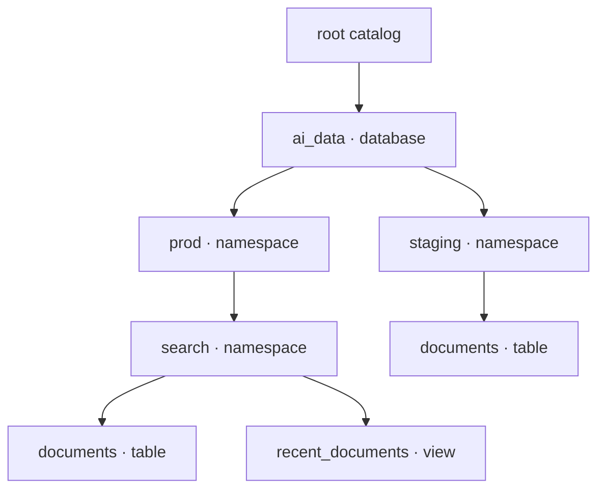

import {
    PyConnect,
    PyConnectAsync,
    PyConnectEnterprisePlaceholders,
    PyConnectObjectStorage,
    PyConnectObjectStorageAsync,
    RsConnect,
    TsConnect,
    TsConnectEnterprisePlaceholders,
    TsConnectObjectStorage,
} from '/snippets/connection.mdx';
import {
    PyStorageS3Minio,
    PyStorageS3Express,
    PyStorageS3SseKms,
    TsStorageS3Minio,
    TsStorageS3Express,
    TsStorageS3SseKms,
} from '/snippets/storage.mdx';

## Catalog Hierarchy {#hierarchy}

A catalog keeps track of named data objects, such as tables and views, so
applications can discover and access them. In LanceDB Enterprise, the
catalog is the top-level entry point: it organizes databases, which in turn
organize namespaces and tables -- similar to a catalog in Postgres,
Snowflake, or other database systems. The catalog itself has no name of its
own -- it's just the root -- and an Enterprise deployment's catalog is
identified by its endpoint, not a name like the objects beneath it.

LanceDB Embedded has no catalog at all. Connect directly to a
[database](#connecting-to-database) instead of going through a catalog.

A database contains namespaces that group related tables and views.
Namespaces can also contain other namespaces, letting teams organize data by
project, environment or purpose.

For example, a search application can keep production and staging data in
separate namespaces within the same database, with `prod` further split into
a nested `search` namespace:

| Object | What it represents |
| --- | --- |
| [Catalog](/management/catalog) | The unnamed root of an Enterprise deployment, identified by its endpoint; lists, creates and drops databases. Not present in Embedded. |
| [Database](/management/database) | A container for namespaces and their data objects. |
| [Namespace](/management/namespace) | A named group of catalog objects -- tables, views, secrets, functions, storage integrations, or nested namespaces -- addressed by its namespace path. |
| [Table](/management/table) | Data stored as rows and columns. |
| [View](/management/view) | A saved query, evaluated when read. Available in Enterprise. |
| [Materialized view](/management/materialized-view) | The stored results of a query, updated by a refresh. Available in Enterprise. |
| [Secret](/management/secret) | A named credential that a Function binds by reference. Available in Enterprise. |
| [Storage integration](/management/storage-integration) | A named credential for reading or importing from storage outside the deployment's own tables, such as an S3 prefix or a HuggingFace repository. Available in Enterprise. |

{/*
Draft for the Functions release. Add this row to the table above:
| [Function](/management/function) | Registered code used to compute column values. Available in Enterprise. |
*/}

### Namespace name and path {#namespace-path}

A namespace's **name** is just its own component, such as `search`. Its
**path** is the full sequence of names from the database down to it: in the
diagram above, `search` sits inside `prod`, so its path is the sequence
`prod`, `search`. A namespace path is never written by joining those names
with `.` -- a dot is a valid character inside a name, so a dot-joined path
couldn't always be split back into its components unambiguously. The two
forms below are how SQL actually writes one.

### Schema {#schema}

SQL addresses a namespace path as a **schema**, the ANSI standard's term for
the same concept: a nested path collapses into one identifier, its
components joined by `$` instead of `.`. The path's length changes what the
schema looks like:

| Path | Schema |
| --- | --- |
| `[]` (the database root) | `public` -- the reserved name for the empty path |
| `["prod"]` | `prod` -- one component needs no joining |
| `["prod", "search"]` | `` `prod$search` `` -- joined, and backtick-quoted because `$` isn't a bare-identifier character |

`$` can't appear in an ordinary name, so a schema can always be split back
into its exact path, unlike a dot-joined one. (This "schema" is the
namespace path as a SQL identifier -- distinct from a table's Arrow schema,
its column names and types.)

### Object identifier {#identifier}

An object -- a table, view, function, secret, or storage integration -- is
addressed in SQL by the ANSI three-part identifier `database.schema.name`,
where `schema` is exactly the `$`-joined path above. The `documents` table
in `search`, nested inside `prod`, in database `ai_data`, is
`` ai_data.`prod$search`.documents ``. One directly under the database root
uses `public`: `ai_data.public.documents`.

See [Namespace](/sql/ddl/namespace) for the full `CREATE`/`ALTER`/`DROP`
syntax.

## Connecting {#connecting}

You always run table and query operations within a **database**; cross-database
operations go through SQL instead. The same Python, TypeScript and Rust SDKs
reach a database and the catalog separately.

### Connecting to Catalog {#connecting-to-catalog}

`connect_catalog(endpoint)` connects to Enterprise's root catalog, which can
list, create and drop databases across the whole deployment. Its
`connect_database(name)` and `create_database(name)` then return the same
kind of database connection `lancedb.connect()` does.

This connection is for database administration, not table or query work:
list, create and drop databases through it, then switch to a **database**
connection for everything else -- tables, queries, and SQL all run within a
database, never directly against the catalog. Local filesystem and
object-store deployments have no catalog to connect to -- each is already
scoped to one database.

### Connecting to Database {#connecting-to-database}

`lancedb.connect(uri)` opens one database in a single call -- a local
directory, an object-storage path, or (with a `db://` URI) a specific
Enterprise database. The table below shows which URI reaches which kind of
database directly.

| URI | Mode | Where queries run |
| --- | --- | --- |
| A local path, such as `./data` | <Badge color="green">Embedded</Badge> | In your process |
| `s3://`, `gs://` or `az://` | <Badge color="green">Embedded</Badge> | In your process, reading object storage |
| `db://` | <Badge color="red">Enterprise</Badge> | On your cluster |

#### A local directory {#local}

Embedded in your application, LanceDB reads and writes the tables in a
directory on disk.

<CodeGroup>
    <CodeBlock filename="Python (sync)" language="Python" icon="python">
    {PyConnect}
    </CodeBlock>

    <CodeBlock filename="Python (async)" language="Python" icon="python">
    {PyConnectAsync}
    </CodeBlock>

    <CodeBlock filename="TypeScript" language="TypeScript" icon="square-js">
    { "import * as lancedb from \"@lancedb/lancedb\";\n\n" }
    {TsConnect}
    </CodeBlock>

    <CodeBlock filename="Rust" language="Rust" icon="rust">
    { "use lancedb::connect;\n" }
    { "\n" }
    {RsConnect}
    </CodeBlock>
</CodeGroup>

#### Object storage {#object-storage}

With an object storage URI the library is still embedded: your process runs
every query and reads and writes the bucket directly, with credentials from
its environment or its connection's `storage_options`.

<CodeGroup>
    <CodeBlock filename="Python (sync)" language="Python" icon="python">
    {PyConnectObjectStorage}
    </CodeBlock>

    <CodeBlock filename="Python (async)" language="Python" icon="python">
    {PyConnectObjectStorageAsync}
    </CodeBlock>

    <CodeBlock filename="TypeScript" language="TypeScript" icon="square-js">
    { "import * as lancedb from \"@lancedb/lancedb\";\n\n" }
    {TsConnectObjectStorage}
    </CodeBlock>
</CodeGroup>

In Rust, pass the same URI to `connect`.

LanceDB supports these object storage backends:

| Backend | URI scheme | Credentials |
| --- | --- | --- |
| AWS S3, and S3-compatible stores (MinIO, Tigris, ...) | `s3://` | `AWS_ACCESS_KEY_ID` / `AWS_SECRET_ACCESS_KEY`, or `storage_options`. Compatible stores also need `endpoint` and `region`. |
| Google Cloud Storage | `gs://` | `GOOGLE_SERVICE_ACCOUNT` (path to a service account JSON), or `storage_options` |
| Azure Blob Storage | `az://` | `AZURE_STORAGE_ACCOUNT_NAME` + `AZURE_STORAGE_ACCOUNT_KEY` (or a SAS token), or `storage_options` |
| Tencent COS | `cos://` | `TENCENTCLOUD_SECRET_ID` / `TENCENTCLOUD_SECRET_KEY`, or `storage_options` |
| GooseFS (a cache layer over COS or S3) | `goosefs://` | Reads from the GooseFS client environment |

Pass credentials as environment variables (uppercase), or as a
`storage_options` dict at connection or table level (lowercase keys); a
table's `storage_options` inherit the connection's and override on a
per-key basis.

Choosing among these is a tradeoff between latency, scalability, cost and
operational complexity, before you even pick a cloud-specific backend:
object storage (S3, GCS, Azure Blob) has the highest latency but is the
cheapest and scales storage effectively without limit; networked file
storage (EFS, Filestore, Azure Files) and third-party stores (MinIO,
WekaFS) sit in between; block storage (EBS, Persistent Disk, Managed Disk)
and local NVMe are the fastest but tie data to one instance, so scaling
means sharding or copying it yourself.

##### S3-compatible stores {#s3-compatible-stores}

<CodeGroup>
    <CodeBlock filename="Python" language="Python" icon="python">
    {PyStorageS3Minio}
    </CodeBlock>
    <CodeBlock filename="TypeScript" language="TypeScript" icon="square-js">
    {TsStorageS3Minio}
    </CodeBlock>
</CodeGroup>

If the endpoint is `http://` (common in local development), also set
`ALLOW_HTTP=true` or pass `allow_http=True` in `storage_options`.

##### S3 Express {#s3-express}

<CodeGroup>
    <CodeBlock filename="Python" language="Python" icon="python">
    {PyStorageS3Express}
    </CodeBlock>
    <CodeBlock filename="TypeScript" language="TypeScript" icon="square-js">
    {TsStorageS3Express}
    </CodeBlock>
</CodeGroup>

Consult AWS's networking requirements for S3 Express before enabling it.

##### Server-side encryption with KMS {#server-side-encryption-with-kms}

Set `aws_server_side_encryption` to `aws:kms` and `aws_sse_kms_key_id` to
the key ID or ARN to encrypt at rest with an AWS KMS key. The same options
apply at connection or table level, and combine with bucket-level default
encryption.

<CodeGroup>
    <CodeBlock filename="Python" language="Python" icon="python">
    {PyStorageS3SseKms}
    </CodeBlock>
    <CodeBlock filename="TypeScript" language="TypeScript" icon="square-js">
    {TsStorageS3SseKms}
    </CodeBlock>
</CodeGroup>

The IAM principal needs `kms:Encrypt`, `kms:Decrypt` and
`kms:GenerateDataKey` on the configured KMS key.

<Note>
**Tencent COS and GooseFS build availability.** Both are bundled by
default in the Python wheel. In the Node binding, GooseFS is bundled by
default but COS is not -- build with the `cos` Cargo feature enabled to
use it there. In Rust, neither is in the default feature set; build with
the `cos` or `goosefs` Cargo feature enabled to use either one.
</Note>

#### LanceDB Enterprise {#enterprise}

A `db://` URI connects directly to one database in LanceDB Enterprise, where
your cluster runs queries and background work. Get the database URI, API key,
region and endpoint from your administrator, then replace the placeholders
below. Use your cluster's region in place of `us-east-1`. In application code,
load credentials from environment variables or a secrets manager.

<CodeGroup>
    <CodeBlock filename="Python" language="Python" icon="python">
    {PyConnectEnterprisePlaceholders}
    </CodeBlock>

    <CodeBlock filename="TypeScript" language="TypeScript" icon="square-js">
    { "import * as lancedb from \"@lancedb/lancedb\";\n\n" }
    {TsConnectEnterprisePlaceholders}
    </CodeBlock>
</CodeGroup>

In Rust, enable the crate's `remote` feature; the connection builder then takes
the same settings through `api_key`, `region` and `host_override`. To use OAuth
instead of an API key, see
[Authentication](/enterprise/authentication); for every connection option, see
[Database](/management/database#deployment).

## Organization and access control {#governance}

- **Separate projects and environments.** Keep production and staging tables
  in distinct namespaces, even when they use the same table names.
- **Find shared datasets.** Give teams a consistent place to discover and
  access the data they work with.
- **Control access in Enterprise.** Use permissions on databases, namespaces
  and tables to manage who can access shared data and what they can do with it.

## Learn more {#next}

- [Catalog](/management/catalog): initial access to a new deployment, and the superuser bootstrap.
- [Databases](/management/database): connect to and manage a database.
- [Namespaces](/management/namespace): create groups and address tables within them.
- [Tables](/management/table): create, inspect and manage your data.
- [Views](/management/view) and [materialized views](/management/materialized-view): work with query-defined data.
- [Secrets](/management/secret): store a credential that a Function can bind by reference.
- [Storage integrations](/management/storage-integration): read or import from storage outside your own tables.
- [Authorization](/governance/authorization): configure Enterprise access permissions.
