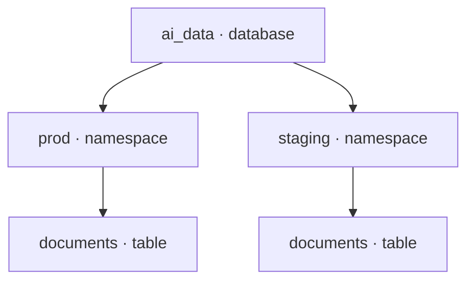

import {
    PyConnect,
    PyConnectAsync,
    PyConnectEnterprisePlaceholders,
    PyConnectObjectStorage,
    PyConnectObjectStorageAsync,
    RsConnect,
    TsConnect,
    TsConnectEnterprisePlaceholders,
    TsConnectObjectStorage,
} from '/snippets/connection.mdx';

## Catalog overview {#catalog}

A catalog keeps track of named data objects, such as tables and views, so
applications can discover and access them. In LanceDB, it organizes those
objects into databases and namespaces -- similar to a catalog in Postgres,
Snowflake, or other database systems.

## Connecting {#connecting}

You always run table and query operations within a **database**; cross-database
operations go through SQL instead. The same Python, TypeScript and Rust SDKs
reach a database two ways:

- **Directly, the common case.** `lancedb.connect(uri)` opens one database in a
  single call -- a local directory, an object-storage path, or (with a `db://`
  URI) a specific Enterprise database.
- **Through the catalog, for admin and cross-database work.** `connect_catalog(endpoint)`
  connects to Enterprise's root catalog, which can list, create and drop
  databases across the whole deployment. Its `connect_database(name)` and
  `create_database(name)` then return the same kind of database connection
  `lancedb.connect()` does. Local filesystem and object-store deployments have
  no catalog to connect to -- each is already scoped to one database.

The table below shows which URI reaches which kind of database directly.

| URI | Where queries run |
| --- | --- |
| A local path, such as `./data` | Embedded: in your process |
| `s3://`, `gs://` or `az://` | Embedded: in your process, reading object storage |
| `db://` | LanceDB Enterprise: queries run on your cluster |

### A local directory {#local}

Embedded in your application, LanceDB reads and writes the tables in a
directory on disk.

<CodeGroup>
    <CodeBlock filename="Python (sync)" language="Python" icon="python">
    {PyConnect}
    </CodeBlock>

    <CodeBlock filename="Python (async)" language="Python" icon="python">
    {PyConnectAsync}
    </CodeBlock>

    <CodeBlock filename="TypeScript" language="TypeScript" icon="square-js">
    { "import * as lancedb from \"@lancedb/lancedb\";\n\n" }
    {TsConnect}
    </CodeBlock>

    <CodeBlock filename="Rust" language="Rust" icon="rust">
    { "use lancedb::connect;\n" }
    { "\n" }
    {RsConnect}
    </CodeBlock>
</CodeGroup>

### Object storage {#object-storage}

With an object storage URI the library is still embedded: your process runs
every query and reads and writes the bucket directly, with the credentials from
its environment or its storage options. [Configuring storage](/deployment/storage)
covers credentials, endpoints and provider options.

<CodeGroup>
    <CodeBlock filename="Python (sync)" language="Python" icon="python">
    {PyConnectObjectStorage}
    </CodeBlock>

    <CodeBlock filename="Python (async)" language="Python" icon="python">
    {PyConnectObjectStorageAsync}
    </CodeBlock>

    <CodeBlock filename="TypeScript" language="TypeScript" icon="square-js">
    { "import * as lancedb from \"@lancedb/lancedb\";\n\n" }
    {TsConnectObjectStorage}
    </CodeBlock>
</CodeGroup>

In Rust, pass the same URI to `connect`.

### LanceDB Enterprise {#enterprise}

A `db://` URI connects directly to one database in LanceDB Enterprise, where
your cluster runs queries and background work. Get the database URI, API key,
region and endpoint from your administrator, then replace the placeholders
below. Use your cluster's region in place of `us-east-1`. In application code,
load credentials from environment variables or a secrets manager.

<CodeGroup>
    <CodeBlock filename="Python" language="Python" icon="python">
    {PyConnectEnterprisePlaceholders}
    </CodeBlock>

    <CodeBlock filename="TypeScript" language="TypeScript" icon="square-js">
    { "import * as lancedb from \"@lancedb/lancedb\";\n\n" }
    {TsConnectEnterprisePlaceholders}
    </CodeBlock>
</CodeGroup>

In Rust, enable the crate's `remote` feature; the connection builder then takes
the same settings through `api_key`, `region` and `host_override`. To use OAuth
instead of an API key, see
[Authentication](/enterprise/authentication); for every connection option, see
[Database](/management/database#deployment).

## Databases, namespaces and tables {#objects}

A database contains namespaces that group related tables and views. Namespaces
can also contain other namespaces, allowing teams to organize data by project,
environment or purpose.

For example, a search application can keep production and staging data in
separate namespaces within the same database:

| Object | What it represents |
| --- | --- |
| [Database](/management/database) | A container for namespaces and their data objects. |
| [Namespace](/management/namespace) | A named group of tables, views or nested namespaces. |
| [Table](/management/table) | Data stored as rows and columns. |
| [View](/management/view) | A saved query, evaluated when read. Available in Enterprise. |
| [Materialized view](/management/materialized-view) | The stored results of a query, updated by a refresh. Available in Enterprise. |
| [Secret](/management/secret) | A named credential that a Function binds by reference. Available in Enterprise. |

{/*
Draft for the Functions release. Add this row to the table above:
| [Function](/management/function) | Registered code used to compute column values. Available in Enterprise. |
*/}

## Organization and access control {#governance}

- **Separate projects and environments.** Keep production and staging tables
  in distinct namespaces, even when they use the same table names.
- **Find shared datasets.** Give teams a consistent place to discover and
  access the data they work with.
- **Control access in Enterprise.** Use permissions on databases, namespaces
  and tables to manage who can access shared data and what they can do with it.

## Learn more {#next}

- [Databases](/management/database): connect to and manage a database.
- [Namespaces](/management/namespace): create groups and address tables within them.
- [Tables](/management/table): create, inspect and manage your data.
- [Views](/management/view) and [materialized views](/management/materialized-view): work with query-defined data.
- [Secrets](/management/secret): store a credential that a Function can bind by reference.
- [Authorization](/governance/authorization): configure Enterprise access permissions.
