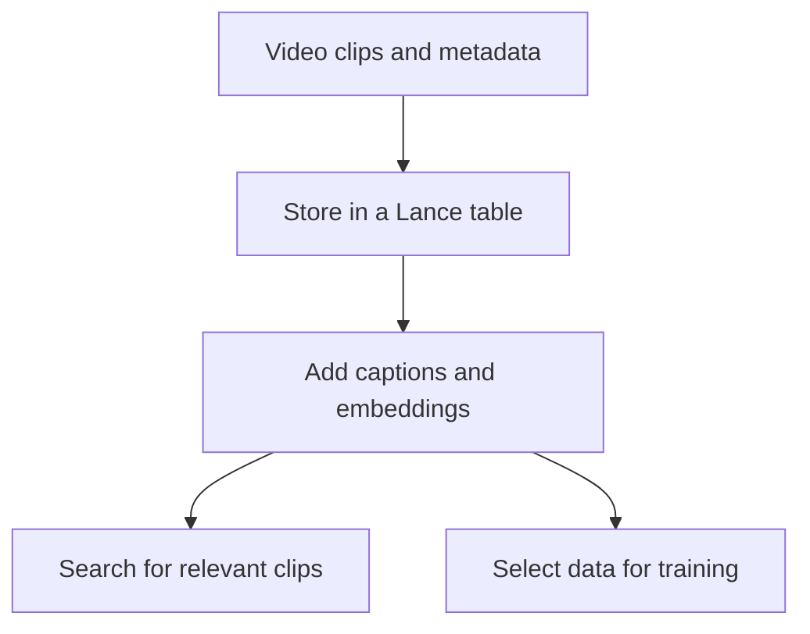

## Multimodal storage and processing {#multimodal}

LanceDB brings storage, search and data processing together for AI workloads.
You can store multimodal data, derive features, search your records and prepare
training datasets using tables built on the open [Lance format](/basics/lance).

The format provides the storage foundation. The [catalog](/basics/catalog)
organizes your tables. LanceDB provides the tools to work with that data.

## Example: a video search workflow {#capabilities}

Consider a team building a video search application:

1. **Ingest the clips.** Store video clips with metadata such as timestamps,
   source and labels.
2. **Add features.** Generate captions and embeddings with your models, and
   store them alongside each clip.
3. **Use the dataset.** Search for relevant clips using embeddings and metadata
   filters, or select a dataset to read into a training framework.

The clips, metadata and derived features stay associated in the same table,
so retrieval and training workflows can use the same dataset. Your training
framework runs the model; LanceDB provides access to the training data.

## Shared compute and maintenance in Enterprise {#where}

LanceDB Embedded runs as an embedded library in your application. LanceDB Enterprise
provides shared infrastructure for applications and teams working with larger
multimodal workloads.

- **Scale resources for different workloads.** Provision query serving and
  background workers independently as search traffic and indexing demand grow.
- **Share data across teams.** Give applications access to shared tables, with
  Enterprise permissions controlling who can read or change them.
- **Manage ongoing maintenance.** Configure background indexing, compaction
  and cleanup as your datasets grow.

See [Architecture](/architecture) for how Enterprise separates storage, query
serving and background work.

## Learn more {#next}

- [Data ingestion](/ingestion): load and update your data.
- [Search](/search): retrieve records with vector, full-text and hybrid search.
- [Feature engineering](/feature-engineering): derive columns and datasets.
- [Training data access](/training/data-loading): read datasets into training workflows.
- [Enterprise](/enterprise): explore deployment options for shared workloads.

{/*
Draft for the Functions release. Add this item to the list above, after
Feature engineering:
- [Functions](/management/function): run Python to compute column values.
*/}
