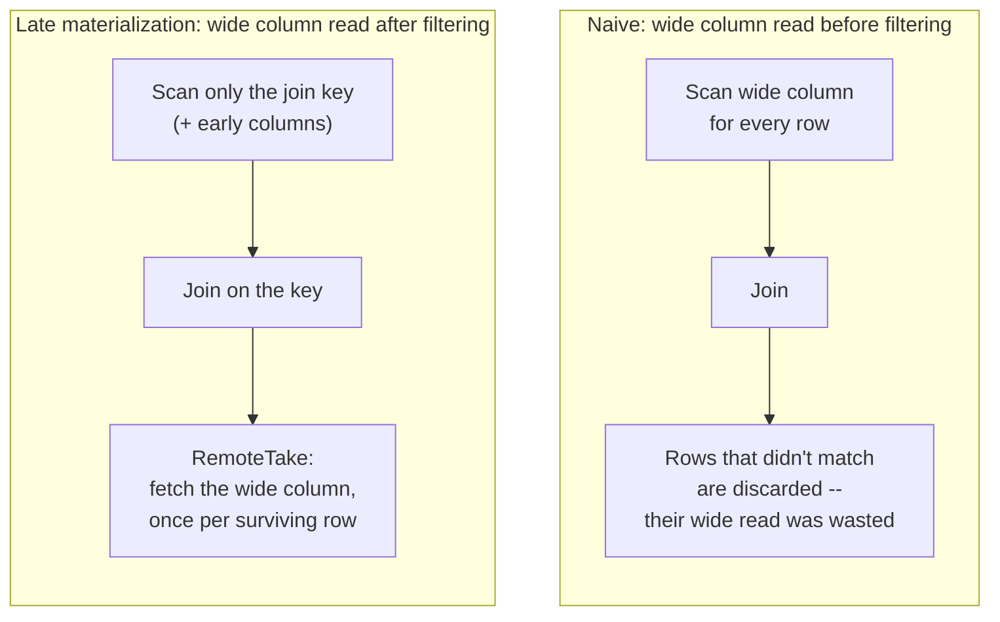

A join that includes a wide column -- a [BlobV2](/management/table#managed-blobs)
or an embedding -- can multiply that column's read far past the result's
own row count: a naive plan reads the wide column for every candidate row
the join considers, then throws most of that work away once the join
condition filters non-matches. Blob late materialization is the
optimizer rewrite that avoids this, deferring the wide read until after
the join has already settled which rows survive.

## The two plan shapes {#plan-shapes}



In the naive plan, the wide column is read once per **candidate** row --
every row either side of the join could possibly produce -- before the
join has thrown any of them away. In the rewritten plan, the join
operates on a narrowed schema (the key, any small "early" columns, and a
row id), and a `RemoteTake` node fetches the wide column afterward, once
per row that actually **survived** the join.

## Eligibility {#eligibility}

This is a physical-plan optimizer rewrite, not something you opt into
with special syntax -- the optimizer decides whether a given join
qualifies. It applies to a plain inner equi-join (a single `ON left_col
= right_col` condition, no additional filter fused into the join, no
`LIMIT` fused into it) where one side -- and only one side -- bottoms out
at a single, otherwise-unfiltered table scan: no existing row filter,
scan range, fragment subset, deleted-row handling, or
[real-time write](/ingestion/realtime-write) tier. If both sides would
otherwise qualify, the side with a BlobV2 column is preferred over the
other; if neither or both sides have one, the rewrite declines rather
than guessing which to narrow.

Which columns actually get deferred differs by which side of the join is
narrowed:

- **The side that builds the join's hash table:** every column beyond
  the join key is deferred, regardless of size. The hash table holds
  everything this side reads for the lifetime of the join, so even a
  modestly-sized column adds up across every row the join holds in
  memory at once.
- **The side that probes the hash table:** only columns wide enough to
  cross a size heuristic are deferred; small columns stay in the initial
  scan, since reading them eagerly doesn't carry the same memory risk.

A BlobV2 column's **descriptor** (small, pointer-like) is early and
stays in the scan either way -- only the raw **bytes** of the blob are
late and deferred, so narrowing doesn't lose track of which rows have a
blob at all, just postpones reading its payload.

## Where the deferred read actually happens {#remotetake}

The take itself runs through the same replica-group-aware routing as any
other distributed table read (see [Horizontal Scaling](/enterprise/horizontal-scaling)) --
it is not shipped back to the query node to be joined there directly.
Routing is resolved once per query and reused across every batch the
take processes, rather than re-resolved per batch, which is what keeps
repeated takes in the same query hitting a cache that's already warm
instead of bouncing between replica groups. Where the executing node
already holds the needed data, the take can also resolve natively
without a separate network round trip at all.

## Confirming it happened {#explain}

A join written this way is a **candidate** for the rewrite, not a
guarantee -- confirm it per query with
[`EXPLAIN`](/basics/sql#query-plans). A `Take` or `RemoteTake` node by
itself isn't proof either way -- it's the general operator that fetches
columns for selected rows from remote storage, and shows up in an
ordinary, join-free query just as it does here (see the
[recorded vector-search plan](/basics/sql#5-data-retrieval)); the
rewrite itself inserts a plain `Take`, which only a later, separate pass
turns into `RemoteTake`. What confirms the deferral specifically is a
`Take`/`RemoteTake` node sitting above a `HashJoinExec`, fetching a
column set that includes `__join_late_materialization_key` -- that key
column only exists when this rewrite fired. Join on a narrow, selective
key and project the wide columns only in the final select list, rather
than alongside the join condition:

<CodeGroup>
```sql SQL icon="database"
SELECT s.frame_id, f.image, f.embedding
FROM selected AS s
JOIN frames AS f ON f.frame_id = s.frame_id
```
</CodeGroup>

`selected` is narrow -- just the frame IDs an earlier curation step
already kept. `frames` is wide -- a BlobV2 `image` and a vector
`embedding` alongside its key. Neither a passing query nor an `EXPLAIN`
that omits `RemoteTake` tells you how much I/O a plan did or did not
save on its own -- use [`EXPLAIN ANALYZE`](/sql/dql/explain) for the
plan's actual row and byte counts, since plain `EXPLAIN` shows the
planned shape without executing the query.

## What to read next {#next}

<CardGroup cols={2}>
  <Card title="Joining datasets" icon="link" href="/curation/join">
    Join types, duplicate keys, and calling a Function across a join.
  </Card>
  <Card title="Joins" icon="link" href="/sql/dql/join">
    Join syntax and semantics in the SQL reference.
  </Card>
  <Card title="Query plans" icon="map" href="/basics/sql#query-plans">
    Reading `EXPLAIN` output in general.
  </Card>
  <Card title="Horizontal Scaling" icon="arrows-left-right" href="/enterprise/horizontal-scaling">
    The replica-group routing a RemoteTake's read goes through.
  </Card>
</CardGroup>
