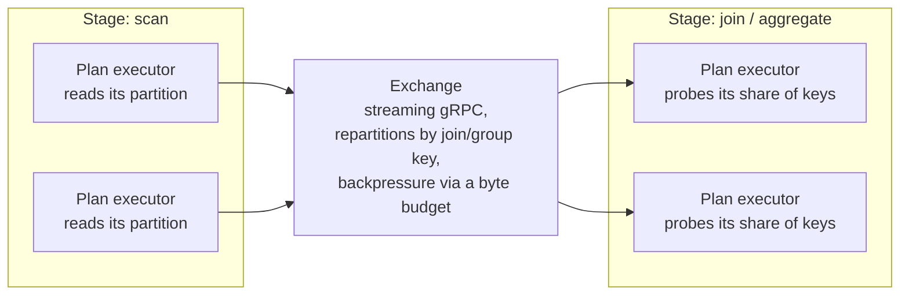

A distributed SQL query plans as a sequence of **stages**, each with its
own set of partitions, connected by an **exchange**: a streaming gRPC
service that carries one stage's output to the next stage's plan
executors. [Distributed SQL](/enterprise/distributed-sql) covers how a
query gets placed on the fleet in the first place; this page covers what
happens between placement and the final result, for a query whose plan
needs data repartitioned across machines -- a hash join or a grouped
aggregate, for example, where rows with the same key must land on the
same worker regardless of which plan executor originally read them.

## Pipelined, not batched {#pipelined}

The exchange moves data as a gRPC stream of row batches, not a file a
later stage waits for: a consuming plan executor pulls batches as they
become available, and a slow consumer throttles its producer through a
byte budget on unread messages rather than letting memory grow without
bound. A partition that stops being read -- for example the probe side of
a hash join whose build side turned out empty -- is drained rather than
left to stall the budget for every other partition sharing the same
connection.

## What to read next {#next}

<CardGroup cols={2}>
  <Card title="Distributed SQL" icon="diagram-project" href="/enterprise/distributed-sql">
    How a query gets placed on the query-serving fleet or a job worker.
  </Card>
  <Card title="Query plans" icon="map" href="/basics/sql#query-plans">
    Inspect a specific query's plan and its actual execution metrics.
  </Card>
</CardGroup>
