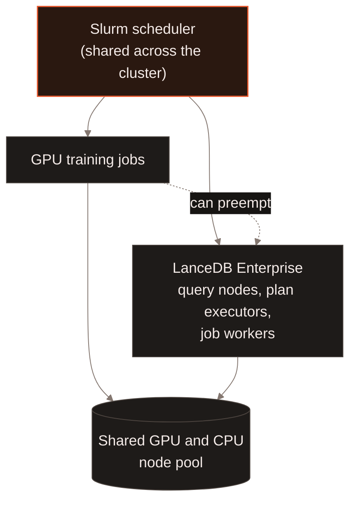
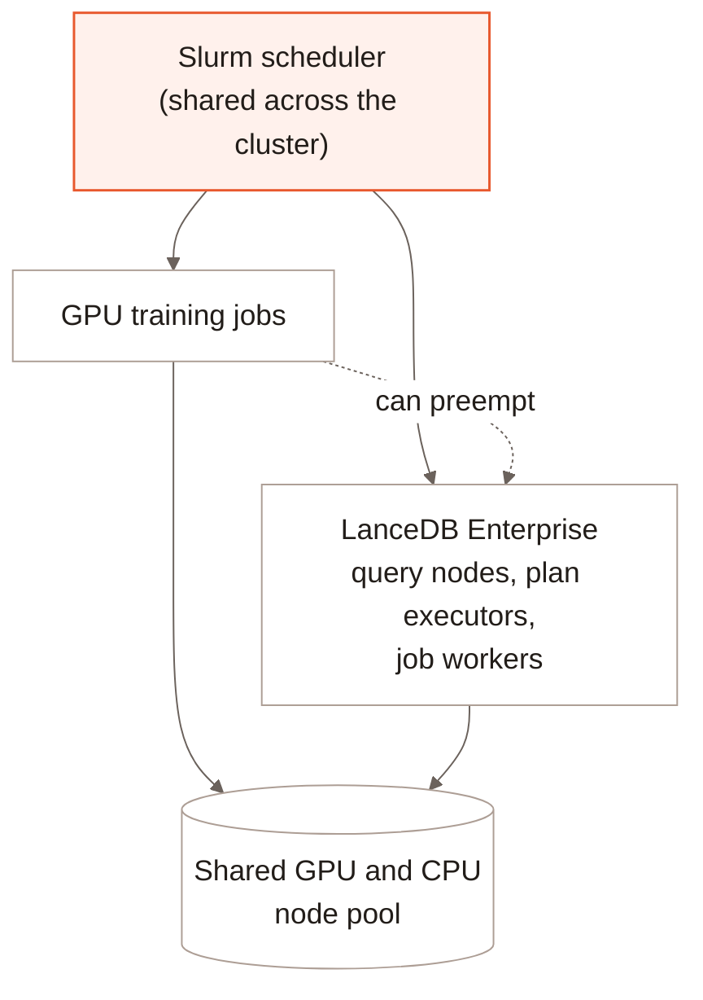

[Slurm](https://slurm.schedmd.com/) is the workload manager most GPU
clusters run to schedule and account for jobs -- queueing work across
shared nodes, enforcing fair-share and priority policies between teams,
and tracking GPU-hour usage per job. That makes it the de facto standard
in AI training infrastructure, where expensive GPU nodes are shared
across many training and data jobs instead of dedicated to one team.
GPU-focused cloud providers ("Neoclouds") such as CoreWeave and Nebius
run Slurm-based scheduling across their Kubernetes clusters for exactly
this reason.

LanceDB Enterprise's own pods -- query nodes, plan executors, and
background job workers alike -- can run as Slurm-scheduled jobs instead
of plain Kubernetes pods, under the same scheduling and accounting as
everything else on the cluster. That means Slurm's fair-share and
priority policies apply to LanceDB the same way they apply to a training
job: it queues for capacity like any other workload, and higher-priority
work can preempt it.

## How it fits together {#architecture}

Without this, LanceDB's pods and GPU training jobs would compete for the
same physical nodes invisibly to each other -- Slurm would have no idea
LanceDB was using capacity it thinks is free, and vice versa. Scheduling
LanceDB's pods through Slurm puts both workloads under one scheduler, so
the cluster's capacity is accounted for consistently regardless of which
one is using it.

## Why it matters {#why-it-matters}

Most GPU infrastructure already runs Slurm for training. Deploying LanceDB
Enterprise into that same infrastructure, under the same scheduler, means
it can share capacity with training workloads safely -- queued, accounted,
and preemptible like everything else -- instead of requiring a separate,
dedicated pool of nodes carved out just for LanceDB. That makes it
practical to run LanceDB directly alongside training on Neoclouds built
around Slurm-based GPU scheduling.

[Contact us](https://www.lancedb.com/contact) to learn more about running
LanceDB Enterprise on a Slurm-scheduled cluster.

## What to read next {#next}

<CardGroup cols={2}>
  <Card title="Architecture" icon="sitemap" href="/index#architecture">
    The query, executor, cache and jobs fleets this scheduling applies to.
  </Card>
  <Card title="Slurm Scheduling for refresh" icon="server" href="/enterprise/slurm-refresh-scheduling">
    Cross-cloud execution: keep orchestration in your cloud, run GPU UDFs on a Neocloud's Slurm cluster.
  </Card>
</CardGroup>
