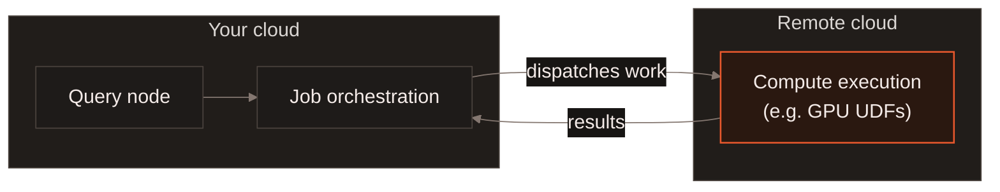
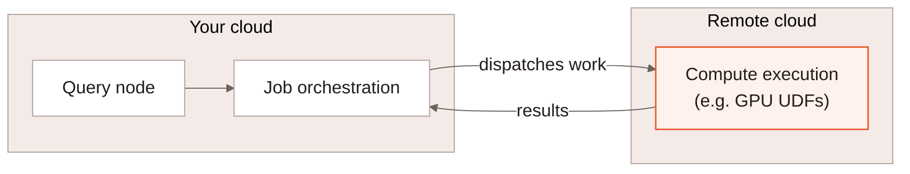

A LanceDB Enterprise deployment doesn't have to keep all of its compute in
one cloud. Orchestration -- query nodes, job coordination, the catalog --
stays with your deployment in its own cloud account and region. Specific,
compute-heavy work, such as a GPU-bound Function's execution during a
refresh, can instead dispatch to run in a **different** cloud account,
region, or provider entirely, and send its results back to complete the job.

## How it fits together {#architecture}

Your deployment's job orchestration plans the work and tracks it to
completion the same way it would locally. The part that actually needs the
remote capacity -- a GPU UDF call, for example -- runs across a network
boundary instead of on a worker in your own cloud, and reports its result
back the same way a local worker would.

## Why it matters {#why-it-matters}

The cloud that's right for your primary deployment -- where your data and
other infrastructure already live -- isn't always the cloud with the best
GPU availability or pricing. Splitting orchestration from execution means
you don't have to choose: keep your deployment where it already makes
sense, and reach compute capacity elsewhere only for the work that
actually needs it, without migrating the deployment or operating that
remote capacity yourself.

[Contact us](https://www.lancedb.com/contact) to learn more about setting
up cross-cloud execution for your deployment.

## What to read next {#next}

<CardGroup cols={2}>
  <Card title="Slurm" icon="server" href="/deployment/slurm">
    A common way the remote cloud's compute gets scheduled: as Slurm jobs.
  </Card>
  <Card title="Adaptive Execution" icon="gauge-high" href="/enterprise/adaptive-execution">
    How a refresh's resource class, part size and worker count adjust themselves.
  </Card>
</CardGroup>
