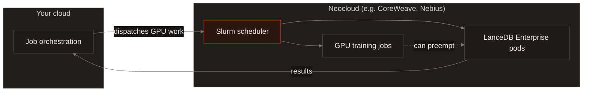
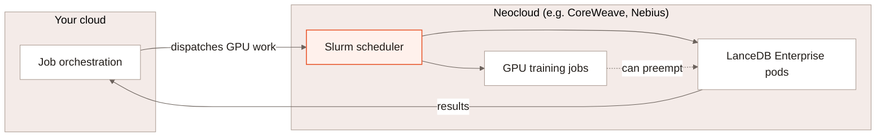

[Slurm](https://slurm.schedmd.com/) is the workload manager most GPU
clusters run to schedule and account for jobs -- queueing work across
shared nodes, enforcing fair-share and priority policies between teams,
and tracking GPU-hour usage per job. That makes it the de facto standard
in AI training infrastructure, where expensive GPU nodes are shared
across many training and data jobs instead of dedicated to one team.
GPU-focused cloud providers ("Neoclouds") such as CoreWeave and Nebius run
Slurm-based scheduling across their Kubernetes clusters for exactly this
reason.

Slurm shows up for LanceDB Enterprise in two related ways. Its own pods --
query nodes, plan executors, and background job workers alike -- can run
as Slurm-scheduled jobs rather than plain Kubernetes pods, under the same
scheduling and accounting as everything else on the cluster. And in the
[multicloud](/deployment/multicloud) case, when the remote cloud is a
Neocloud, Slurm is commonly how the dispatched GPU work actually gets
scheduled there.

## How it fits together {#architecture}

Scheduling LanceDB's pods through Slurm puts them under the same
scheduler as GPU training jobs, so the cluster's capacity is accounted
for consistently regardless of which one is using it -- Slurm's
fair-share and priority policies apply to LanceDB the same way they
apply to a training job, including preemption when training needs the
capacity back.

## Why it matters {#why-it-matters}

Most GPU infrastructure already runs Slurm for training. Deploying LanceDB
Enterprise into that same infrastructure, under the same scheduler, means
it can share capacity with training workloads safely -- queued, accounted,
and preemptible like everything else -- instead of requiring a separate,
dedicated pool of nodes carved out just for LanceDB. Combined with
[multicloud](/deployment/multicloud) dispatch, that makes it practical to
keep your primary deployment wherever it already lives and still reach
GPU capacity on a Neocloud built around Slurm, only for the work that
needs it.

[Contact us](https://www.lancedb.com/contact) to learn more about running
LanceDB Enterprise on a Slurm-scheduled cluster.

## What to read next {#next}

<CardGroup cols={2}>
  <Card title="Multicloud" icon="cloud" href="/deployment/multicloud">
    The cross-cloud dispatch model this page's Neocloud case builds on.
  </Card>
  <Card title="Architecture" icon="sitemap" href="/index#architecture">
    The query, executor, cache and jobs fleets this scheduling applies to.
  </Card>
</CardGroup>
