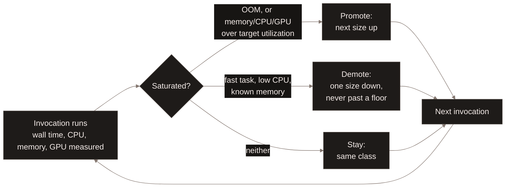
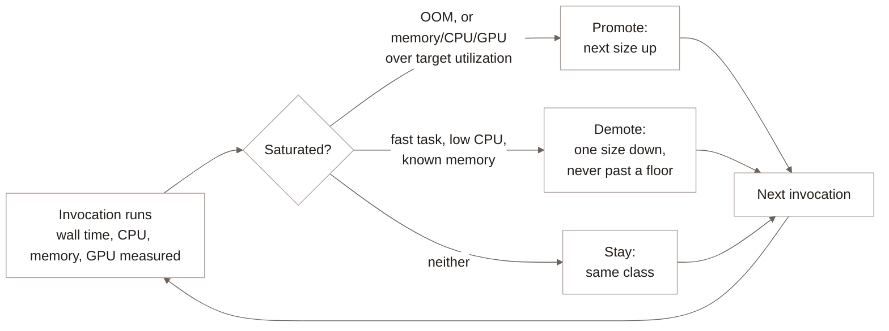

<Badge color="purple">Early access</Badge>

When a [computed column](/feature-engineering/add-computed-column) or
[materialized view](/feature-engineering/materialized-views) is filled by
a registered [Function](/curation/create-function), LanceDB Enterprise
adapts the refresh to the Function's actual behavior along several axes --
how many rows go in one unit of work, how much CPU, memory and GPU one
invocation gets, how many worker processes run inside one worker, and how
many workers run at all -- rather than running it at one fixed shape
regardless of how slow, fast, or resource-hungry that Function turns out
to be. See [Architecture](/index#architecture).

## Part size follows observed throughput {#part-size}

A Function refresh starts with a small probe part -- 10 rows -- and grows
it based on an exponentially-weighted average of rows processed per
millisecond, aiming each next part at roughly 45 seconds of work. A part
can grow or shrink by at most 16x from the previous one, so one unusually
slow or fast part doesn't swing sizing to an extreme; the ceiling is
1,000,000 rows per part regardless of how fast the Function appears to
run. A consistently slow Function converges on small parts that finish
reliably; a fast one converges on large parts that keep worker overhead
-- a fresh scanner and registry round trip per part -- small relative to
the work done.

## Resource class follows observed consumption {#resource-consumption}

Each invocation is measured -- wall time, CPU time and utilization, peak
memory, out-of-memory events, and for a GPU Function, compute and memory
utilization per GPU -- and that measurement decides whether the *next*
invocation runs with more resources, fewer, or the same:

**Promotion** happens on an out-of-memory event, memory utilization above
70% of the class's limit, or CPU pegged at 85%+ for a sample long enough
(5 seconds) that one fast spike isn't mistaken for sustained saturation. A
GPU Function promotes the same way on GPU compute or GPU memory
saturation. **Demotion** is more conservative: only a task that both
finished fast (under 30 seconds) and used 25% or less of its CPU budget
demotes, one size down at a time rather than jumping straight to the
smallest class, and never below a configured floor. Either way, the class
actually chosen is the smallest one whose memory and CPU both cover the
observed peak with roughly 40% headroom, so sizing tracks what the
Function actually consumes rather than a static guess made once at
registration.

## Process and worker count follow the resource budget {#sizing}

Within one worker, the number of executor processes is chosen to be the
largest count that still fits the worker's memory budget, since memory
per process shrinks as the count grows. Across workers, the fleet claims
as many additional workers as the configured CPU, memory and GPU budget
has room for, given what's already running -- the worker count grows to
use available budget rather than running at a single fixed count
regardless of how much of the budget sits idle.

## Checkpoint granularity follows part size {#checkpointing}

A refresh checkpoints once per part, not on a separately-tuned interval --
so checkpoint frequency is a direct consequence of the same EWMA-driven
part sizing described above, not a second knob. A Function that converges
on small parts checkpoints often, losing little work if a worker dies
mid-refresh; one that converges on large parts checkpoints less often,
trading that for lower per-part overhead. See
[Checkpointing](/enterprise/checkpointing) for the mechanism itself.

## Overriding the defaults {#override}

A refresh can request a GPU class and count, or cap the maximum rows per
Function call directly, instead of relying on this adaptive behavior --
see [Configure workers and resources](/feature-engineering/refresh-column#resources)
for the full set of overrides, SQL and SDK alike. Setting `batch_size`
caps the rows passed to each Function call for that refresh; the adaptive
part sizing described above still decides how many rows each part covers.

## What to read next {#next}

<CardGroup cols={2}>
  <Card title="Incremental Refresh" icon="arrow-rotate-right" href="/enterprise/incremental-refresh">
    How the rows a Function refresh works on are chosen in the first place.
  </Card>
  <Card title="Checkpointing" icon="floppy-disk" href="/enterprise/checkpointing">
    How a part's progress survives a failure or restart.
  </Card>
</CardGroup>
