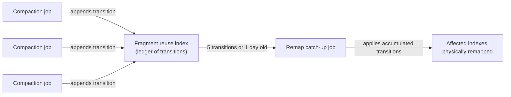

[Compaction](/maintenance/compaction) rewrites fragments into fewer, larger
files, which changes the physical row address -- file and offset -- of every
row it moves. An index built against the old layout stores exactly those
addresses, so a naive compaction would leave any index covering the rewritten
fragments pointing at rows that have moved or no longer exist there.

LanceDB Embedded avoids this by never letting the two run independently:
`optimize()` compacts and remaps affected indexes in the same call, before
returning. LanceDB Enterprise runs them as separate, independently scheduled
background jobs -- a table can compact while an index build is still
catching up from an earlier compaction -- so it needs a way to keep an index
correct without forcing every compaction to wait for a synchronous remap.

## The fragment reuse index {#fri}

The **fragment reuse index** (FRI) is a Lance format-level mechanism, not an
Enterprise add-on: a system index that records every fragment rewrite as a
**transition** -- the source fragments' digests, the destination fragments'
digests, and a row-address mapping between them (`Transition` and `Mapping`
in `lance-table`'s `system_index::frag_reuse::ledger`). An index that covers
a rewritten fragment does not need to be rebuilt before the rewrite commits;
it can instead translate the row addresses it already stores forward through
the chain of recorded transitions at read time.

Every commit -- compaction included -- is classified against the table's
current indexes before it is admitted. A rewrite that touches only fragments
no index covers is admitted as ordinary business, with nothing appended to
the FRI. A rewrite that touches fragments an index *does* cover must append a
transition recording how those rows moved, so that index stays correct
without being rebuilt synchronously. This classification is Lance's own
commit protocol (`lance-table`'s `frag_reuse::gate::classify`), the same one
every write funnels through -- it is not a lock or a sequencing rule Enterprise
imposes from outside.

## Enterprise defers and batches the catch-up {#catch-up}

Translating addresses through a long chain of transitions at every read adds
up, so Enterprise does not let the FRI grow without bound. Its job planner
tracks how many transitions have accumulated for a table and schedules a
dedicated **remap catch-up** job -- which applies the accumulated transitions
to the indexes that need them, physically, in one pass -- once either:

- the FRI reaches **5 pending transitions** (`remap_fri_version_threshold`,
  tunable), or
- the oldest pending transition is **1 day old**
  (`remap_fri_max_age_secs`, tunable), whichever comes first.

The version count only climbs while a table keeps compacting, so the age
threshold exists to clear a lingering FRI -- and the per-read remap cost that
comes with it -- on a table that stops compacting before reaching the count
threshold, without scheduling a catch-up job on every table that is still
actively compacting. This is what lets compaction and index maintenance run
as separate background jobs in [Background jobs](/maintenance/background-jobs#index)
rather than one blocking on the other: a handful of compactions can land
before their indexes are physically remapped, and the catch-up job amortizes
that remap across all of them in one job instead of one per compaction.

## What to read next {#next}

<CardGroup cols={2}>
  <Card title="Compaction and cleanup" icon="broom" href="/maintenance/compaction">
    What compaction merges, and how the embedded library runs it in one call.
  </Card>
  <Card title="Background jobs" icon="gears" href="/maintenance/background-jobs#index">
    The `index_remap` job type, and the other maintenance jobs Enterprise schedules.
  </Card>
  <Card title="Distributed compaction" icon="layer-group" href="/enterprise/distributed-compaction">
    How compaction itself scales across the jobs fleet.
  </Card>
  <Card title="Distributed indexing" icon="diagram-project" href="/enterprise/distributed-indexing">
    How an index build scales across the jobs fleet.
  </Card>
</CardGroup>
