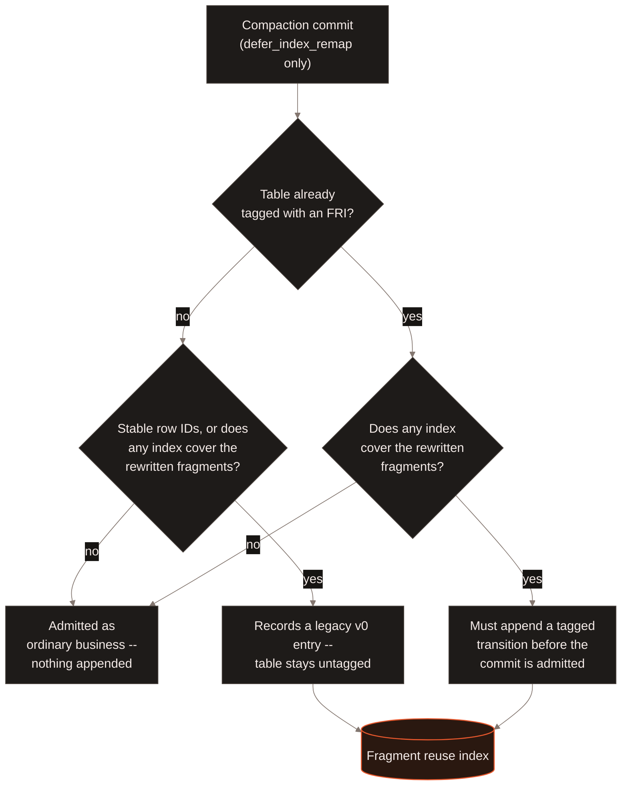
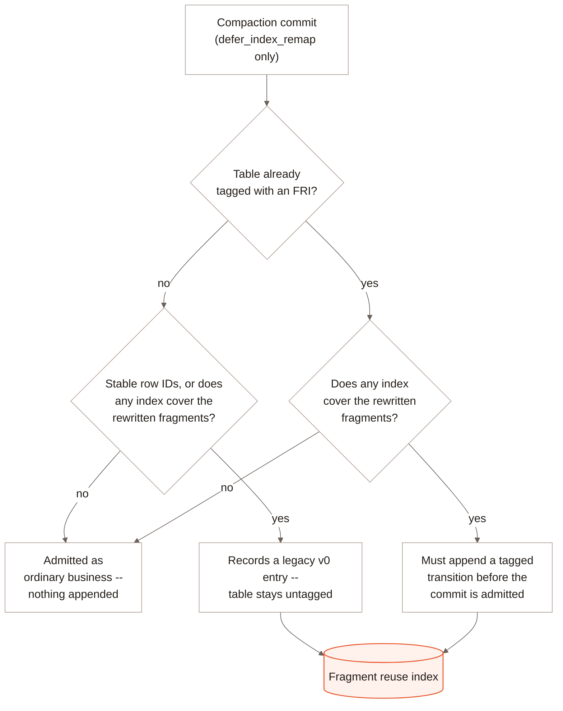
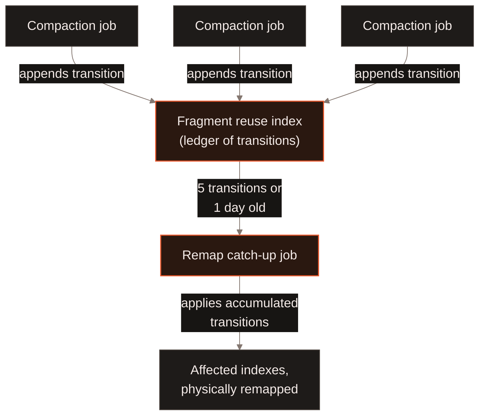
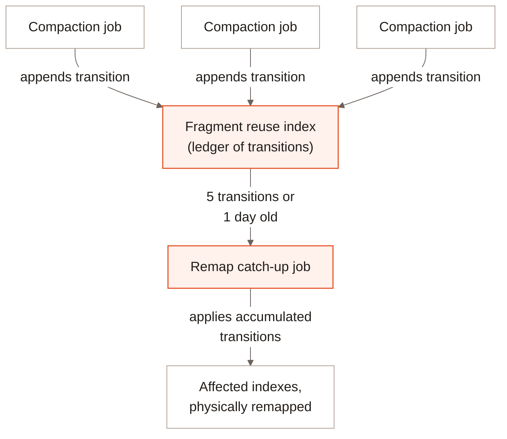

[Compaction](/maintenance/compaction) rewrites fragments into fewer, larger
files, which changes the physical row address -- file and offset -- of every
row it moves. An index built against the old layout stores exactly those
addresses, so a naive compaction would leave any index covering the rewritten
fragments pointing at rows that have moved or no longer exist there.

LanceDB Embedded avoids this by default by never letting the two run
independently: `optimize()` compacts and remaps affected indexes in the
same call, before returning. Compaction's `defer_index_remap` option opts
out of that -- the call returns once compaction itself commits, leaving
the remap for later -- which is what lets a custom remapper or a
stable-row-ID table skip the synchronous step. LanceDB Enterprise schedules
automatic compaction and indexing independently, so an eligible table can compact
while an index build is still catching up from earlier compaction. Deferred
remapping keeps indexes correct without making every automatic compaction wait
for a synchronous remap. Explicit
[manual compaction](/maintenance/compaction#enterprise-manual-compaction) uses one
worker with atomic execution and inline index remapping instead.

## The fragment reuse index {#fri}

The **fragment reuse index** (FRI) is a Lance format-level mechanism, not an
Enterprise add-on: a system index that records every fragment rewrite as a
**transition** -- the source fragments' digests, the destination fragments'
digests, and a row-address mapping between them (`Transition` and `Mapping`
in `lance-table`'s `system_index::frag_reuse::ledger`). An index that covers
a rewritten fragment does not need to be rebuilt before the rewrite commits;
it can instead translate the row addresses it already stores forward through
the chain of recorded transitions at read time.

Only a compaction run with `defer_index_remap` ever touches the FRI; a
synchronous-remap rewrite -- the Embedded default -- never tags a table or
appends anything. Every `defer_index_remap` commit is classified before
it is admitted; that classifier is Lance's own commit protocol
(`lance-table`'s `frag_reuse::gate::classify`), the same one every write
funnels through -- not a lock or a sequencing rule Enterprise imposes from
outside. A table starts **untagged**: its deferred rewrites are admitted
as ordinary business with nothing appended, unless the rewrite has
stable row IDs to translate or touches a fragment an index covers -- either
one makes that commit record a legacy, untagged ("v0") FRI entry, which
does **not** tag the table. Tagging is a separate, one-way transition (a
sticky manifest flag that a later trim never clears) that publishes the
FRI's first real transition; this page does not cover what triggers it.
Once a table is tagged, its commits are classified against which indexes
cover the rewritten fragments the way the rest of this page describes, and
every entry it records from then on is a tagged transition, never v0
again. A table with stable row IDs is permanently confined to the
untagged, v0 form -- Lance refuses to tag it at all -- so its deferred
compactions keep recording v0 entries indefinitely, for every rewrite that
moves row addresses, not only ones that touch an indexed fragment: the
address translation itself depends on that record, independent of
indexing.

Once a table is tagged, Lance refuses a compaction that does not set
`defer_index_remap`, including a plain Embedded `optimize()` call: an
Enterprise-tagged table has to keep deferring the remap, or be compacted
by a writer that can remap the tagged history eagerly.

## Enterprise defers and batches the catch-up {#catch-up}

Translating addresses through a long chain of transitions at every read adds
up, so Enterprise does not let the FRI grow without bound. Its job planner
tracks how many transitions have accumulated for a table and schedules a
dedicated **remap catch-up** job -- which applies the accumulated transitions
to the indexes that need them, physically, in one pass -- once either:

- the FRI reaches **5 pending transitions** (`remap_fri_version_threshold`,
  tunable), or
- the oldest pending transition is **1 day old**
  (`remap_fri_max_age_secs`, tunable), whichever comes first.

The version count only climbs while a table keeps compacting, so the age
threshold exists to clear a lingering FRI -- and the per-read remap cost that
comes with it -- on a table that stops compacting before reaching the count
threshold, without scheduling a catch-up job on every table that is still
actively compacting. This is what lets compaction and index maintenance run
as separate background jobs (see
[Index maintenance jobs](/indexing/incremental-indexing#index))
rather than one blocking on the other: a handful of compactions can land
before their indexes are physically remapped, and the catch-up job amortizes
that remap across all of them in one job instead of one per compaction.

## What to read next {#next}

<CardGroup cols={2}>
  <Card title="Compaction and cleanup" icon="broom" href="/maintenance/compaction">
    What compaction merges, and how the embedded library runs it in one call.
  </Card>
  <Card title="Incremental Indexing" icon="arrows-rotate" href="/indexing/incremental-indexing#index">
    The `index_remap` job type, and keeping an index current as the table changes.
  </Card>
  <Card title="Distributed Compaction" icon="layer-group" href="/enterprise/distributed-compaction">
    How compaction itself scales across the jobs fleet.
  </Card>
  <Card title="Distributed Indexing" icon="diagram-project" href="/enterprise/distributed-indexing">
    How an index build scales across the jobs fleet.
  </Card>
</CardGroup>
