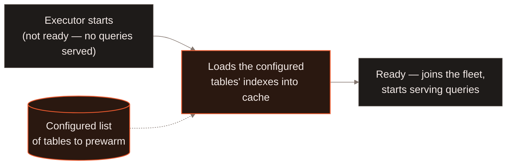
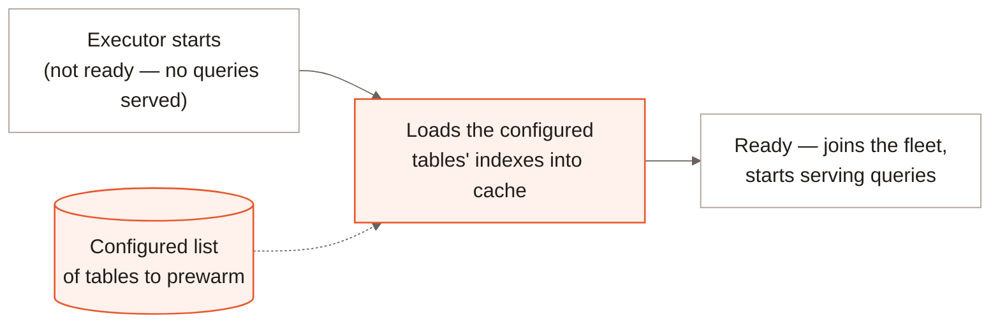

Enterprise supports two kinds of cache prewarm: startup index prewarm fills
the [tiered index cache](/enterprise/tiered-index-cache), and
[on-demand data prewarm](#on-demand-data-prewarm) fills the
[data page cache](/enterprise/data-page-cache) through a durable job.

For startup index prewarm, you configure which tables to warm. Each
executor loads those tables' indexes before it joins the fleet. The executor
does not accept queries until startup prewarming finishes.

These Enterprise caches are not available in LanceDB Embedded.
Embedded does have its own, separate `prewarm_index()` on a table --
an idempotent hint that loads a built index into memory ahead of a query.

<div className="hidden dark:block">



</div>

<div className="block dark:hidden">



</div>

## Why it matters {#why-it-matters}

Without prewarming, a fresh or restarted executor would fill its indexes
lazily, so the first queries it serves pay the cost of loading and
deserializing them from object storage. Holding the executor out of the
fleet until its configured tables are warm means every query it ever
serves gets a warm cache, so performance stays consistent through restarts
and rollouts instead of dipping right after each one.

[Contact us](https://www.lancedb.com/contact) to learn more about how
prewarming is configured for your deployment.

## On-demand data prewarm {#on-demand-data-prewarm}

On compatible Enterprise deployments, the SDK submits data prewarm through
SQL. Flight SQL connectivity is required; the existing generic HTTP job API is
used to inspect or wait for the durable warming job. Under Standard
authorization, submission requires table Select plus Usage on the database
and namespace hierarchy. Job events require System Usage and cancellation
requires System Operate.

The table handle determines the database, namespace, and branch in every SDK.

<Tabs>
<Tab title="Python">
```python
from datetime import timedelta

job = table.prewarm_data_async(
    ["video"], filter="quality > $minimum",
    parameters={"minimum": 0.7}, concurrency=4
)
print(job.id)
result = job.wait(timeout=timedelta(minutes=10), progress=print)
print(result.table_version, result.executors_completed, result.fragments_selected)

# Reattach in a later process using the same database connection settings.
db.open_job(job.id).wait()
```
</Tab>
<Tab title="TypeScript">
```typescript
const job = await table.prewarmDataAsync({
  columns: ["video"],
  filter: "quality > $1",
  parameters: [0.7],
  concurrency: 4,
});
console.log(job.id);
const result = await job.wait({ timeoutMs: 600_000, onProgress: console.log });
console.log(result.tableVersion, result.executorsCompleted);

// Reattach using the same database connection settings.
if (job.id !== null) {
  await (await db.openJob(job.id)).wait();
}
```
</Tab>
<Tab title="Rust">
```rust
use std::time::Duration;
use std::sync::Arc;
use arrow_array::{ArrayRef, Float64Array, RecordBatch};
use lancedb::job::JobWaitOptions;
use lancedb::table::{PrewarmDataOptions, PrewarmDataResult};

let parameters = RecordBatch::try_from_iter([
    ("minimum", Arc::new(Float64Array::from(vec![0.7])) as ArrayRef),
])?;
let job = table
    .prewarm_data_async(
        PrewarmDataOptions::new()
            .columns(["video"])
            .filter("quality > $minimum")
            .parameters(parameters)
            .concurrency(4),
    )
    .await?;
println!("{:?}", job.id());
let result = job.wait_with_options(
    JobWaitOptions::new().timeout(Duration::from_secs(600)),
).await?;
println!("Snapshot {}: {:?} executors completed", result.table_version, result.executors_completed);

// Reattach using the same database connection settings.
if let Some(id) = job.id() {
    db.open_job(id).await?.into_typed::<PrewarmDataResult>()?.wait().await?;
}
```
</Tab>
</Tabs>

The method returns when the job is accepted. Waiting finishes when warming
reaches a terminal state; a timeout does not cancel the job. Use
`job.refresh()` and `job.spec["table_version"]` to inspect the captured source
version. In Python's asynchronous API, await submission and `job.wait()`.
The TypeScript SDK exposes
`table.prewarmDataAsync({ columns, filter, parameters, concurrency })` with the
same lifecycle.

Pass `parameters` alongside a filter to bind positional `$1`/`$2` or named
`$name` values. Python accepts a sequence, mapping, or one-row Arrow batch/table;
TypeScript accepts a scalar array, named object, or one-row Arrow batch/table.
Rust accepts a one-row Arrow `RecordBatch`. Values travel separately from SQL
text, and table/column identifiers, branch, and concurrency retain their existing
interfaces. Existing literal filters continue to work without parameters.

Bound filters require an Enterprise server that supports parameterized PREWARM.
The server accepts up to 1,024 scalar parameters and 64 KiB of encoded Arrow IPC.
Missing, unused, malformed, oversized, and unsupported bindings fail before job
creation. TypeScript encodes safe integer numbers and bigint as Int64 and
fractional numbers as Float64; use Arrow input when an explicit type is needed.

Waiting returns a typed `PrewarmDataResult`: the pinned source version,
selected fragment count, targeted/completed executor counts, and partial
executor count when reported. Completed executors include partial completions;
`executors_partial` is that subset, which can reflect cache pressure. These are observations of executor work, not a guarantee that every
page remains resident. Counters omitted by older workers stay unknown.

The current executor status protocol does not report byte/range measurements
for nonempty prewarms, so `bytes_read` and `ranges_completed` are None/null there.
A new worker performing an empty plan reports known zero work. Progress exposes
planning/dispatch phases, selected fragments, executor fan-out, and the latest
active/completed/partial/failed executor counts without inventing percentages.
In Python, `job.wait(progress=True)` displays completed executors. Pass a
callback instead to inspect the full structured snapshots.

The Enterprise administrative CLI supports the same lifecycle:

```bash
lancedb admin cache prewarm data --profile production --table events \
  --column payload --filter 'id >= 1000' --concurrency 4 \
  --wait --wait-timeout-seconds 600 --poll-interval-seconds 5
```

SQL submission and preview use the same options. Submission returns a job ID
and pinned source version; preview creates no job:

```sql
PREWARM WITH (concurrency = 4) AS SELECT payload FROM events WHERE id >= 1000;
EXPLAIN PREWARM WITH (concurrency = 4) AS SELECT payload FROM events WHERE id >= 1000;
EXPLAIN (FORMAT JSON) PREWARM WITH (concurrency = 4) AS SELECT payload FROM events WHERE id >= 1000;
DESCRIBE JOB '<job_id>' FORMAT JSON;
```

The typed SDK preview helpers return a `PrewarmDataPlan` with the source table
version, readable plan, and structured pruning summary. They require an Enterprise
deployment supporting `EXPLAIN (FORMAT JSON) PREWARM` and Flight SQL connectivity.
Preview requires table Select plus Usage on the database and namespace hierarchy;
it creates no warming job and does not use the job-monitoring APIs.

<Tabs>
<Tab title="Python">
```python
from lancedb.prewarm import PrewarmDataPlan

plan: PrewarmDataPlan = table.explain_prewarm_data(
    ["payload"], filter="id >= $minimum", parameters={"minimum": 1000}, concurrency=4
)
print(plan.table_version)
print(plan.pruning.mode)
print(plan.pruning.selected_fragments, plan.pruning.input_fragments)
print(plan.pruning.selected_row_ranges, plan.pruning.fallback_reason)
```

With an `AsyncTable`, use `await table.explain_prewarm_data(...)` with the same
arguments. It returns the same plan type.
</Tab>
<Tab title="TypeScript">
```typescript
import type { PrewarmDataPlan } from "@lancedb/lancedb";

const plan: PrewarmDataPlan = await table.explainPrewarmData({
  columns: ["payload"],
  filter: "id >= $minimum",
  parameters: { minimum: 1000 },
  concurrency: 4,
});
console.log(plan.tableVersion);
console.log(plan.pruning.mode);
console.log(plan.pruning.selectedFragments, plan.pruning.inputFragments);
console.log(plan.pruning.selectedRowRanges, plan.pruning.fallbackReason);
```
</Tab>
<Tab title="Rust">
```rust
use std::sync::Arc;
use arrow_array::{ArrayRef, Int64Array, RecordBatch};
use lancedb::table::{PrewarmDataOptions, PrewarmDataPlan};

let parameters = RecordBatch::try_from_iter([
    ("minimum", Arc::new(Int64Array::from(vec![1000])) as ArrayRef),
])?;
let plan: PrewarmDataPlan = table
    .explain_prewarm_data(
        PrewarmDataOptions::new()
            .columns(["payload"])
            .filter("id >= $minimum")
            .parameters(parameters)
            .concurrency(4),
    )
    .await?;
println!(
    "Snapshot {}: {} of {} fragments selected",
    plan.table_version, plan.pruning.selected_fragments, plan.pruning.input_fragments
);
println!(
    "Mode: {}, candidate ranges: {:?}, fallback: {:?}",
    plan.pruning.mode, plan.pruning.selected_row_ranges, plan.pruning.fallback_reason
);
```
</Tab>
</Tabs>

The `plan` string is for display; use `pruning` for structured facts. Selected
row ranges are conservative physical candidate intervals, not exact matching
rows. Unavailable range counts remain None/null; a reported zero means no
candidate ranges. The fallback reason describes why pruning was unavailable,
when reported. Pruning modes may expand in future server versions. A preview does not reserve its snapshot: a later submission
resolves and plans its own source version. Unsupported servers fail explicitly
without falling back to text parsing or REST.

Python's SQL interface also accepts bindings for a preview without submitting a
warming job:

```python
plan = db.execute_query(
    "EXPLAIN PREWARM AS SELECT video FROM clips WHERE quality > $minimum",
    parameters={"minimum": 0.7},
).read_all()
```

The filter is a single SQL predicate used for conservative metadata pruning.
Unknown or unavailable metadata keeps data eligible for warming. Omitted
columns warm all fields; concurrency must be a positive integer. Historical
version checkouts are unsupported: use the latest version of the selected
branch. The server never needs to scan rows merely to evaluate the predicate.

`prewarm_data(columns, filter=..., parameters=..., concurrency=...)` and
`prewarmData({ columns, filter, parameters, concurrency })` accept the same
options as the job-returning methods but return after acceptance without retaining the handle.
The existing TypeScript `prewarmData(columns)` array form remains supported.
Rust `prewarm_data()` also accepts the same `PrewarmDataOptions` as durable
submission and Explain, including filters and concurrency:

```rust
use lancedb::table::PrewarmDataOptions;

table.prewarm_data(PrewarmDataOptions::new()
    .columns(["video"])
    .filter("quality > 0.7")
    .concurrency(4)).await?;
```

Existing Rust `prewarm_data(None)` and `prewarm_data(Some(columns))` calls remain
supported. The convenience method returns after acceptance and discards the job
handle; it does not poll for warming completion.

These methods require SQL PREWARM support and Flight SQL connectivity.
Unsupported servers fail without a REST fallback or silently
dropping options. Repeated submissions may create distinct jobs; warming
already-cached data is safe. Index prewarm keeps its existing behavior.

## What to read next {#next}

<CardGroup cols={2}>
  <Card title="Data Page Cache" icon="database" href="/enterprise/data-page-cache">
    The raw-data-page cache populated by on-demand data prewarm jobs.
  </Card>
  <Card title="Tiered Index Cache" icon="layer-group" href="/enterprise/tiered-index-cache">
    The deserialized-index cache populated by startup index prewarm.
  </Card>
  <Card title="Architecture" icon="diagram-project" href="/index#architecture">
    Where executors and query nodes sit in the serving fleet.
  </Card>
</CardGroup>
