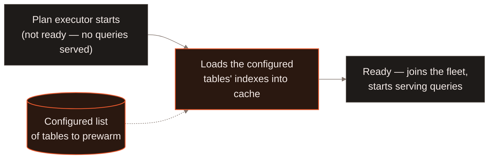
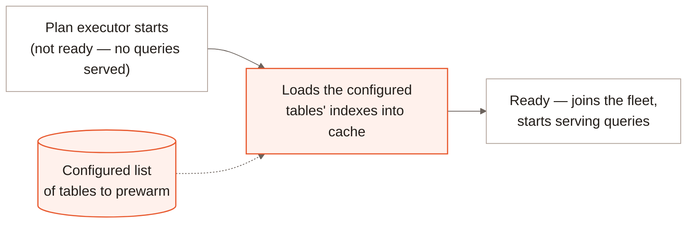

Enterprise supports two kinds of cache prewarm: startup index prewarm fills
the [tiered index cache](/enterprise/tiered-index-cache), and
[on-demand data prewarm](#on-demand-data-prewarm) fills the
[data page cache](/enterprise/data-page-cache) through a durable job.

For startup index prewarm, you configure which tables to warm. Each plan
executor loads those tables' indexes before it joins the fleet. The executor
does not accept queries until startup prewarming finishes.

These Enterprise caches are not available in LanceDB Embedded.
Embedded does have its own, separate `prewarm_index()` on a table --
an idempotent hint that loads a built index into memory ahead of a query.

<div className="hidden dark:block">



</div>

<div className="block dark:hidden">



</div>

## Why it matters {#why-it-matters}

Without prewarming, a fresh or restarted executor would fill its indexes
lazily, so the first queries it serves pay the cost of loading and
deserializing them from object storage. Holding the executor out of the
fleet until its configured tables are warm means every query it ever
serves gets a warm cache, so performance stays consistent through restarts
and rollouts instead of dipping right after each one.

[Contact us](https://www.lancedb.com/contact) to learn more about how
prewarming is configured for your deployment.

## On-demand data prewarm {#on-demand-data-prewarm}

On compatible Enterprise deployments, the SDK submits data prewarm through
SQL. Flight SQL connectivity is required; the existing generic HTTP job API is
used to inspect or wait for the durable warming job. Under Standard
authorization, submission requires table Select plus Usage on the database
and namespace hierarchy. Job events require System Usage and cancellation
requires System Operate.

The table handle determines the database, namespace, and branch in every SDK.

<Tabs>
<Tab title="Python">
```python
from datetime import timedelta

job = table.prewarm_data_async(
    ["video"], filter="quality > 0.7", concurrency=4
)
print(job.id)
job.wait(timeout=timedelta(minutes=10))

# Reattach in a later process using the same database connection settings.
db.open_job(job.id).wait()
```
</Tab>
<Tab title="TypeScript">
```typescript
const job = await table.prewarmDataAsync({
  columns: ["video"],
  filter: "quality > 0.7",
  concurrency: 4,
});
console.log(job.id);
await job.wait();

// Reattach using the same database connection settings.
if (job.id !== null) {
  await (await db.openJob(job.id)).wait();
}
```
</Tab>
<Tab title="Rust">
```rust
use lancedb::table::PrewarmDataOptions;

let job = table
    .prewarm_data_async(
        PrewarmDataOptions::new()
            .columns(["video"])
            .filter("quality > 0.7")
            .concurrency(4),
    )
    .await?;
println!("{:?}", job.id());
job.wait().await?;

// Reattach using the same database connection settings.
if let Some(id) = job.id() {
    db.open_job(id).await?.wait().await?;
}
```
</Tab>
</Tabs>

The method returns when the job is accepted. Waiting finishes when warming
reaches a terminal state; a timeout does not cancel the job. Use
`job.refresh()` and `job.spec["table_version"]` to inspect the captured source
version. In Python's asynchronous API, await submission and `job.wait()`.
Node exposes `table.prewarmDataAsync({ columns, filter, concurrency })` with
the same lifecycle.

The filter is a single SQL predicate used for conservative metadata pruning.
Unknown or unavailable metadata keeps data eligible for warming. Omitted
columns warm all fields; concurrency must be a positive integer. Historical
version checkouts are unsupported: use the latest version of the selected
branch. The server never needs to scan rows merely to evaluate the predicate.

`prewarm_data(columns)` / `prewarmData(columns)` still return after acceptance
without a job handle, but now also require SQL PREWARM support and Flight SQL
connectivity. Unsupported servers fail without a REST fallback or silently
dropping options. Repeated submissions may create distinct jobs; warming
already-cached data is safe. Index prewarm keeps its existing behavior.

## What to read next {#next}

<CardGroup cols={2}>
  <Card title="Data Page Cache" icon="database" href="/enterprise/data-page-cache">
    The raw-data-page cache populated by on-demand data prewarm jobs.
  </Card>
  <Card title="Tiered Index Cache" icon="layer-group" href="/enterprise/tiered-index-cache">
    The deserialized-index cache populated by startup index prewarm.
  </Card>
  <Card title="Architecture" icon="diagram-project" href="/index#architecture">
    Where plan executors and query nodes sit in the serving fleet.
  </Card>
</CardGroup>
