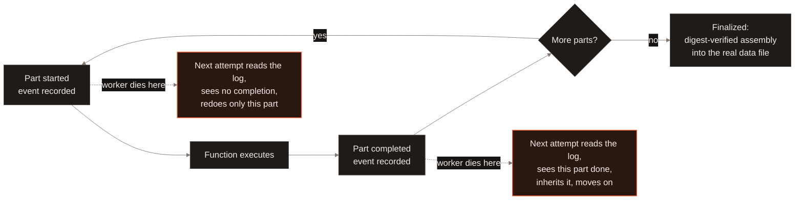
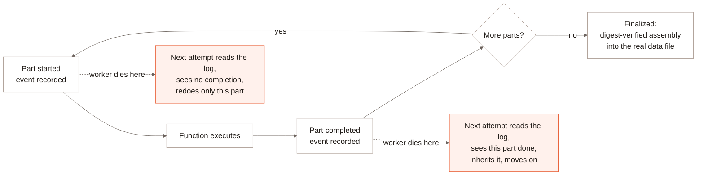

<Badge color="purple">Early access</Badge>

This page is about checkpointing a [Function refresh](/enterprise/adaptive-execution)
specifically -- not [PyTorch training checkpointing](/training/checkpointing),
a different, unrelated mechanism covered elsewhere.

A Function refresh fills a column in [parts](/enterprise/adaptive-execution#part-size),
each one a bounded range of rows. Every part's lifecycle is recorded as a
durable, append-only event -- started, then completed -- in a log scoped
to the data file that part belongs to. A worker failure or restart does
not require redoing the refresh from scratch: the next attempt reads that
log, finds which parts already completed, and only works on what's left.
Retrying is at-least-once at the part level, not exactly-once: a part
that started but never recorded completion is redone in full on the next
attempt, so a Function with external side effects (a remote API call, for
example) can have those side effects repeated for that part's rows.

## What gets recorded, and when {#events}

Each part contributes two events to its data file's log: one when a
worker starts it, one when it completes with the rows it filled, the rows
it skipped, and how long it took. A completed part additionally carries
enough identity that a *different* job -- one that took over after the
part's original job died -- can verify the part is really done and adopt
it rather than redo it. Once every part for a data file has completed,
one last event finalizes it: the assembled file's checksum is verified
against what the parts actually wrote before it's accepted as the real
data file, not just assumed correct because every part reported success.

Writes to this log are batched, not one durable write per event, so
checkpointing a fast-finishing part costs a fraction of a write rather
than a full one.

## The Blob v2 optimization {#blob-v2}

A Function whose output includes a [Blob v2](/management/table#managed-blobs)
column needs an identifier for every blob it writes. Allocating those
IDs piggybacks on the same durable event that already records a part
starting: the event log itself hands out the next unclaimed range,
computed from the highest range any earlier part in this log has already
claimed. This means:

- **No separate allocation round trip.** The ID range arrives for free
  inside a write the part was already going to make durably.
- **A retried part can't collide with itself or with other parts.** Each
  attempt at a part writes a new part-started event and gets a fresh range
  past the highest range already claimed in this log, so no two attempts --
  of the same part or of different parts -- ever hold overlapping ranges.
  Re-sending the *same* event, for example after a lost acknowledgement, is
  idempotent and returns the range it was already given. A range left
  behind by a failed attempt is not reclaimed.

## What to read next {#next}

<CardGroup cols={2}>
  <Card title="Adaptive Execution" icon="gauge-high" href="/enterprise/adaptive-execution">
    Part sizing, and why checkpoint frequency follows it.
  </Card>
  <Card title="Create a Function" icon="code" href="/curation/create-function">
    Shaping a Function, including ones that return Blob v2 output.
  </Card>
</CardGroup>
