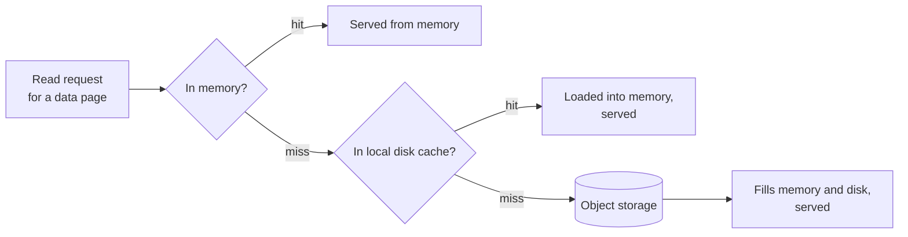

The data page cache holds fixed-size pages of raw table data read from
object storage, keyed by their location, so a later read of the same range
is served from memory or local disk instead of round-tripping to the
backing store. Plan executors and query nodes each keep their own cache for
the pages they serve. A background prewarm job can populate a cache ahead
of a request that needs it, rather than filling it lazily on first read.
See [Architecture](/index#architecture).



For a Helm deployment, configure the volume size and a StorageClass backed
by the intended disks. This example assumes the cluster provides an
NVMe-backed StorageClass named `local-nvme`; use the actual StorageClass
name for your cluster. Enabling disk caching alone does not select NVMe
hardware -- the node storage and StorageClass determine the backing device:

```yaml Helm values
planExecutorNodes:
  diskCache:
    enabled: true
    storageSize: "200Gi"
    storageClassName: "local-nvme"
```

The chart budgets disk capacity between the data page cache and, when
enabled, the separate tiered index cache -- see
[Sharing the disk budget](/enterprise/tiered-index-cache#disk-budget) for
`capacityPercent` and the index tier's own reserved share.

A table's local disk cache shares one budget with the
[tiered index cache](/enterprise/tiered-index-cache#disk-budget)'s disk
tier where both are enabled on the same executor -- raising one's share of
that budget lowers the other's.

## Prewarming on demand {#prewarm}

[Cache Prewarm](/enterprise/cache-prewarm)'s `startup_prewarm_idx` only
warms the [tiered index cache](/enterprise/tiered-index-cache), not this
one. The data page cache has its own, separate on-demand prewarm, run by a
deployment operator rather than called from application code, optionally
scoped to specific columns:

<CodeGroup>
```bash CLI icon="terminal"
lancedb admin cache prewarm data --table embedding_table --column embedding
```
</CodeGroup>

The command returns once the request is accepted, not once prewarming
finishes; it is idempotent and safe to run concurrently from multiple
clients. Prewarming has a large upfront cost, so it pays off for workloads
that repeatedly query the same columns -- large columns such as embeddings
or binary data may not be practical to prewarm this way.

<Warning>
The OSS SDK's `table.prewarm_data()` targets LanceDB Cloud, a different
product; calling it against an Enterprise deployment 404s. Use the admin
command above instead.
</Warning>

## Cache interfaces {#interfaces}

- [Tiered Index Cache](/enterprise/tiered-index-cache) for the related
  cache that holds deserialized index structures instead of raw data pages.
- [Query plans](/basics/sql#query-plans) for inspecting what a query actually read.
