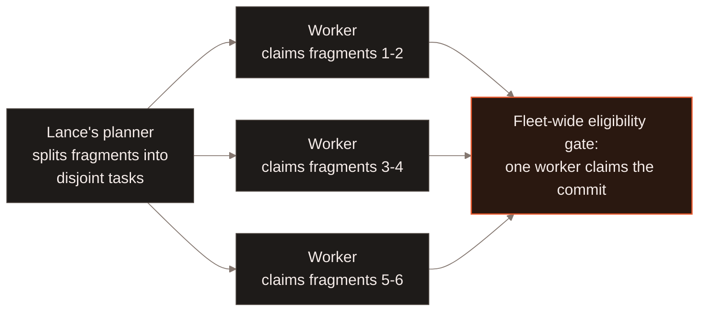
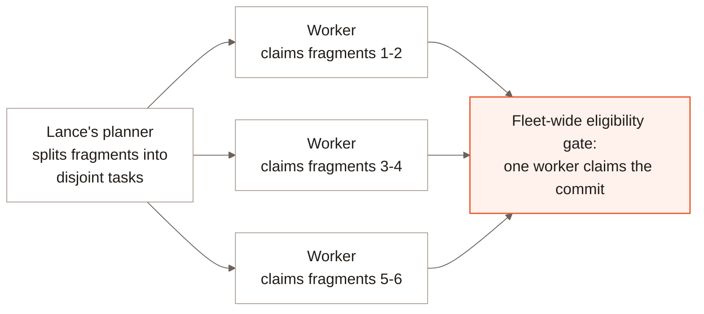

Distributed compaction splits a table's fragments into independent,
fragment-disjoint tasks and fans them out across job workers in LanceDB
Enterprise. Unlike an index build, a compaction plan needs no bin-packing:
Lance's own planner already produces disjoint tasks, so workers claim and
execute them directly, with no coordination needed to decide who does
what. See [Architecture](/index#architecture).

No task depends on another's result, so a worker that finishes early
simply claims another task rather than waiting on its peers. Committing is
where the fleet does coordinate: finished tasks go through a shared
eligibility gate, and only the one worker that claims the commit actually
writes it, rather than each worker committing its own task independently.

Whether a failed task can still let the rest commit depends on the remap
mode. Inline remap is all-or-nothing: one failed task fails the whole job,
since the commit updates every affected index inline and can't skip a
task's share of that. Deferred remap can commit a subset -- a failed
task's fragments are abandoned and replanned in a later round, while the
rest of the job's tasks commit without waiting on it. See
[Advanced Conflict Resolution](/enterprise/advanced-conflict-resolution)
for when compaction defers a remap at all.

Automatic compaction can use this distributed path when table state and index
safety permit it. Explicit CLI, SQL, and SDK compaction jobs use one worker with
atomic execution and inline index remapping. Their tuning resolves from the
invocation, then table settings, then deployment/built-in defaults. Automatic
jobs use table settings before those defaults. See
[manual compaction](/maintenance/compaction#enterprise-manual-compaction) for
submission, the four tuning fields, and job completion checks.

## Compaction interfaces {#compaction-interfaces}

- [Compaction](/maintenance/compaction) for triggering and configuring a compaction.
- [Garbage Collection](/maintenance/cleanup) for removing files compaction and other operations leave behind.
- [Job Framework](/basics/jobs) for the job types a deployment runs on its own schedule.
