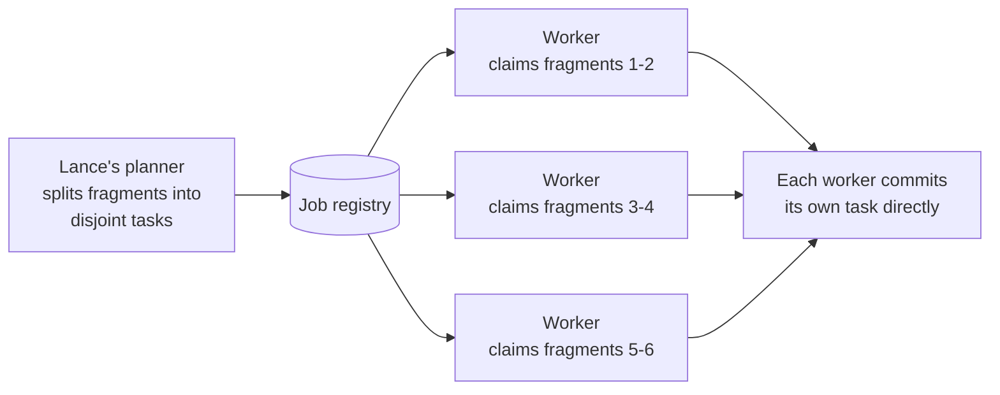

Distributed compaction splits a table's fragments into independent,
fragment-disjoint tasks and fans them out across job workers in LanceDB
Enterprise. Unlike an index build, a compaction plan needs no bin-packing:
Lance's own planner already produces disjoint tasks, so workers claim and
commit them directly through the job registry. See [Architecture](/index#architecture).

No task depends on another's result, so there is nothing to coordinate
beyond the claim itself -- a worker that finishes early simply claims
another task rather than waiting on its peers.

## Compaction interfaces {#compaction-interfaces}

- [Compaction](/maintenance/compaction) for triggering and configuring a compaction.
- [Cleanup](/maintenance/cleanup) for removing files compaction and other operations leave behind.
- [Job Framework](/basics/jobs) for the job types a deployment runs on its own schedule.
