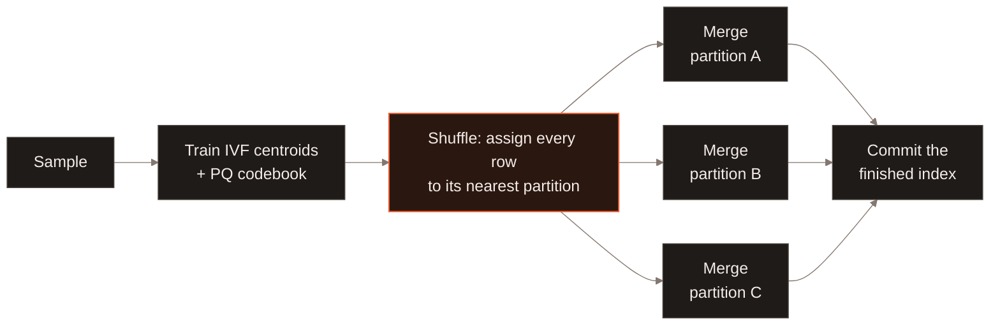
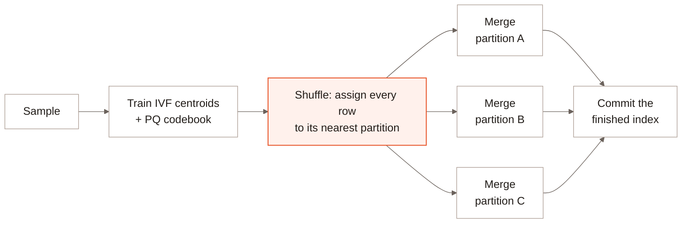

A vector index build splits into stages, and the data in scope narrows at
each one: training works from a small sample, shuffling touches every row
once, and merging works entirely within one partition at a time. Full-text
and scalar index builds skip training and shuffling -- they bin-pack
directly into independent tasks workers claim and build in parallel,
closer to how [distributed compaction](/enterprise/distributed-compaction)
splits work. See [Architecture](/index#architecture).

## Stages of a vector index build {#stages}

1. **Train.** A sample of the table's vectors -- not the full dataset --
   trains the shared model every worker will use: IVF partition centroids,
   and for IVF-PQ, a PQ codebook on top of them.
2. **Shuffle.** Every row in the table gets assigned to its nearest
   trained partition and regrouped so that all of one partition's rows end
   up together, wherever in the table they originally lived.
3. **Merge.** Each partition is now self-contained, so workers build and
   merge partitions in parallel with no cross-partition coordination --
   one worker's output never depends on another's.
4. **Commit.** The finished index is committed to the table.

## Indexing interfaces {#indexing-interfaces}

The shared indexing guides describe how to build and maintain each index
type:

- [Vector indexes](/indexing/vector-index) and [vector search](/search/vector-search).
- [Full-text indexes](/indexing/fts-index) and [full-text search](/search/full-text-search).
- [Scalar indexes](/indexing/scalar-index) and [filtering](/search/filtering).
- [Incremental Indexing](/indexing/incremental-indexing) for triggering and tracking a build.
