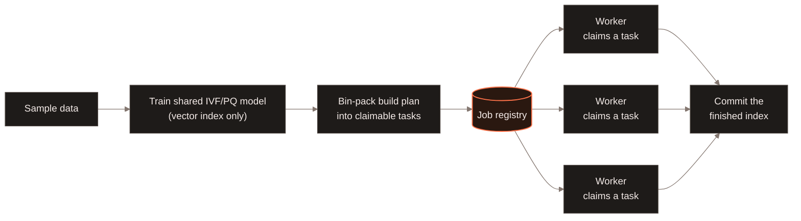
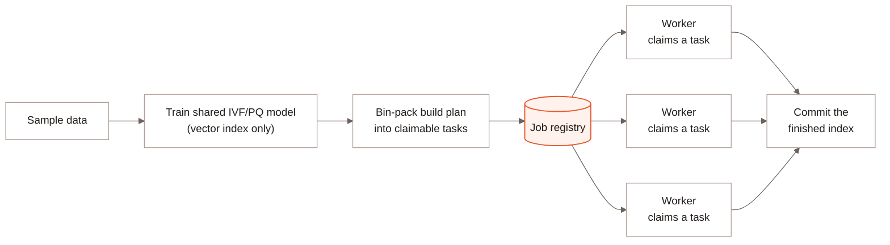

Distributed indexing bin-packs a vector, full-text, or scalar index build into
a plan of claimable tasks, then fans the plan out across job workers in
LanceDB Enterprise. Workers claim tasks independently through the job
registry and commit the finished index together. A vector index build first
trains a shared IVF/PQ model from sampled data, then workers build storage
from that model in parallel. See [Architecture](/index#architecture).

## Indexing interfaces {#indexing-interfaces}

The shared indexing guides describe how to build and maintain each index
type:

- [Vector indexes](/indexing/vector-index) and [vector search](/search/vector-search).
- [Full-text indexes](/indexing/fts-index) and [full-text search](/search/full-text-search).
- [Scalar indexes](/indexing/scalar-index) and [filtering](/search/filtering).
- [Incremental Indexing](/indexing/incremental-indexing) for triggering and tracking a build.
