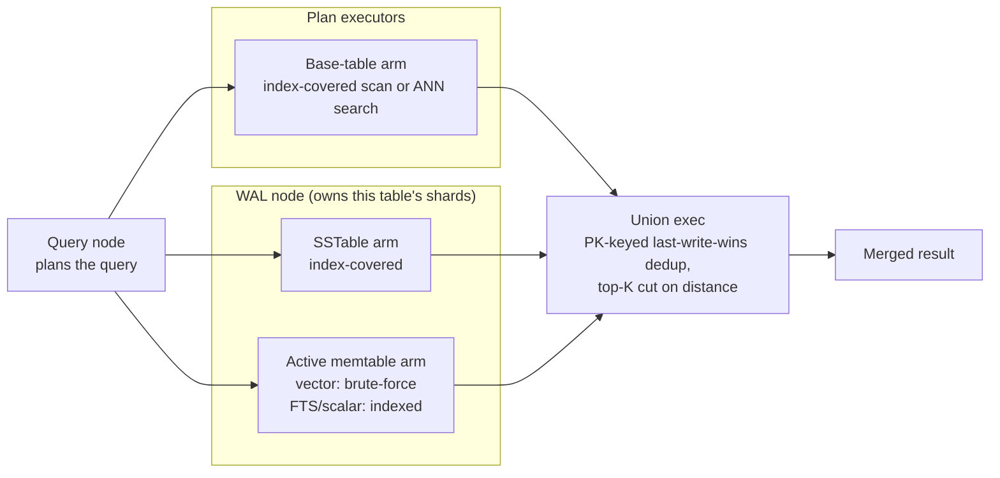

[Real Time Read](/search/realtime-read) covers what a query against an
RTE-enabled table returns: base-table rows merged with the fresh tier,
fresh rows superseding base rows with the same primary key. On a single
Embedded process that merge is one function call against one Lance
dataset. In LanceDB Enterprise, the base table and the fresh tier are
usually served by different machines -- plan executors for the base table,
a [WAL node](/tables/realtime-engine#wal-nodes) for the table's shards --
so a query has to combine their results across the network instead.

## An extra exec node, not a parallel system {#union-exec}

The distributed plan for an RTE-enabled table is an ordinary plan executor
query plan with one additional node spliced in: a union exec that queries
the owning WAL node's shard and merges its rows into the base arm's stream
by primary key, keeping the newest generation on a collision and cutting
back to the requested top-K once both sides have contributed. An optimizer
pass inserts this node only when the query actually touches a WAL-enabled
table; a query that touches none produces a plan identical to one with no
RTE tables involved at all, so RTE adds no overhead to queries that never
use it.

Because the base arm already read through the plan-executor fleet's ordinary
caches and index structures, the only new network hop this adds is the one
to the WAL node that owns the table's shards -- the same WAL node [Real Time
writes](/ingestion/realtime-write) land on, found by the query node through
the same consistent hash of database and table name.

## Semantic search stays index-covered {#index-coverage}

For full-text and scalar search, a maintained index covers every tier the
union exec reads from -- the base table, the WAL node's SSTables, and its
currently-active memtable -- so a row written a moment ago is just as
index-searchable as one written yesterday. If a resident memtable predates
an index being added to the maintained set, the query is rejected outright
rather than silently missing that memtable's rows; there is no code path
that quietly returns an incomplete result.

Vector (ANN) search follows the same rule for the base table and SSTables,
with one deliberate exception: the active memtable itself carries no vector
index. It doesn't need one -- it's small by construction, since it freezes
into an immutable SSTable as soon as it crosses a size threshold, so
comparing every row in it directly is already fast enough to keep writes
searchable within milliseconds. The guarantee this adds up to: every
committed row is covered by a real index except the newest sliver still
sitting in the write buffer, and that sliver is cheap enough to scan in
full rather than needing one.

Both guarantees depend on the table's RTE write spec actually maintaining
the index in question -- by default every index is maintained, but a
deployment that pins a smaller set with `with_maintained_indexes` loses the
guarantee for whatever it leaves out, and a query against an unmaintained
index is rejected the same way, rather than silently searching the base
table alone.

## What to read next {#next}

<CardGroup cols={2}>
  <Card title="Real Time Read" icon="magnifying-glass" href="/search/realtime-read">
    What a query returns, and how Embedded does this same merge in-process.
  </Card>
  <Card title="Distributed Real Time Write" icon="bolt" href="/enterprise/distributed-real-time-write">
    How writes reach the WAL node this page's queries read from.
  </Card>
  <Card title="Distributed search" icon="network-wired" href="/enterprise/distributed-search">
    The ordinary plan-executor path this layers on top of.
  </Card>
</CardGroup>
