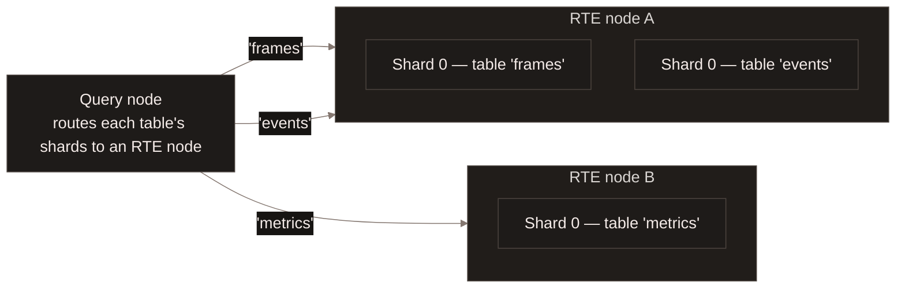
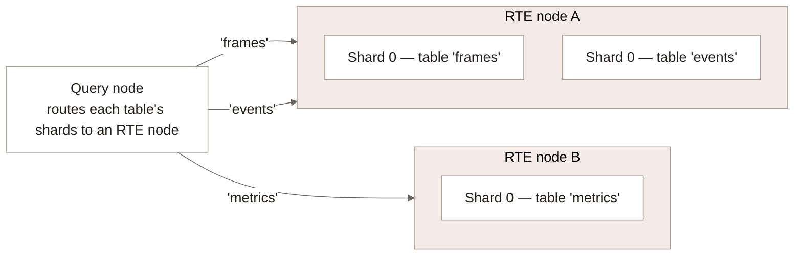

[Real Time writes](/ingestion/realtime-write) describes `table.enable_rte(spec)`
as one call that works the same way on either connection. On Enterprise, that
call does not run locally -- it posts to the server, which installs the write
path on a dedicated, horizontally scalable serving tier instead of running it
in your process. This page covers that tier: how it shards a table's writes,
the one real limit sharding does not remove, and the throughput you can expect.

## How writes are routed {#routing}

Enabling RTE on a remote table sends the spec to the server, which installs
the write path on the dataset instead of running it in your process. From
then on, the query node routes every request for that table -- reads and
writes alike -- to a single owning **RTE node**, a stateful component
separate from the query nodes and plan executors that serve ordinary
queries. A query node routes different tables to different RTE nodes, and
a single RTE node can host shards from many different tables at once. RTE
nodes share nothing but the underlying object storage; no node talks to
another one directly.

## Shards scale one table, replicas scale the cluster {#shards-vs-replicas}

`RTEWriteSpec::bucket(column, num_buckets)` splits a table into `num_buckets`
**table shards**, each a separate, independently-appending stream, giving the
table that many parallel write paths instead of one. A shard's identity is
derived from the table itself, not assigned by an operator, so a shard
survives the table being claimed by a different RTE node later.

This is where the horizontal scaling actually happens: splitting `frames`
into 8 shards gives it 8 independent append streams instead of 1, raising
that table's own write ceiling. Adding RTE node replicas spreads shard
ownership across more nodes, so the cluster can host more tables -- and more
shards -- without any one node becoming a bottleneck for everything it serves.

`RTEWriteSpec::identity(column)` and `RTEWriteSpec::unsharded()` both resolve
to a single table shard -- `bucket` is the sharding mode that actually
parallelizes write throughput; the other two are about routing semantics, not
scaling.

## Throughput {#throughput}

A table shard is the unit of capacity: measured runs show it sustaining
roughly 85-90 MB/s of durable append before acknowledgement, and throughput
scaling nearly linearly with shard count up to at least 8 shards on one
node -- the bottleneck is the durable write itself, not CPU or memory. This
is observed capacity, not an enforced quota; nothing in the deployment caps
a shard's or a table's throughput below it. [Contact
support](https://www.lancedb.com/contact) if your workload needs more write
throughput than this provides.

## What to read next {#next}

<CardGroup cols={2}>
  <Card title="Real Time writes" icon="bolt" href="/ingestion/realtime-write">
    Enable RTE and write to a table; the same call on Embedded or Enterprise.
  </Card>
  <Card title="How the real time engine works" icon="database" href="/tables/realtime-engine">
    MemWAL, shards, memtables and SSTables -- the shared architecture.
  </Card>
  <Card title="Distributed Real Time Read" icon="magnifying-glass" href="/enterprise/distributed-real-time-read">
    How reads combine the WAL tier's fresh rows with the base table across the fleet.
  </Card>
</CardGroup>
