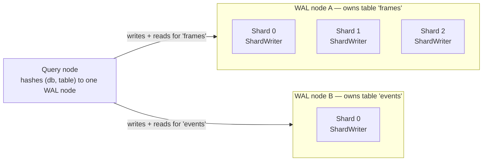

[Real Time writes](/ingestion/realtime-write) describes `table.enable_rte(spec)`
as one call that works the same way on either connection. On Enterprise, that
call does not run locally -- it posts to the server, which installs the write
path on a dedicated, horizontally scalable serving tier instead of running it
in your process. This page covers that tier: how it shards a table's writes,
the one real limit sharding does not remove, and the throughput you can expect.

## The WAL-node tier {#wal-nodes}

Enabling RTE on a remote table sends the spec to the server
(`POST /v1/table/<name>/enable_rte/`), which installs Lance's `__lance_mem_wal`
index on the dataset. From then on, every request for that table -- reads and
writes alike -- is consistent-hashed on the database and table name to a
single owning **WAL node**, a stateful pod separate from the query nodes and
plan executors that serve ordinary queries. WAL node pods share nothing but
the underlying object storage; no pod talks to another one directly.

## Shards scale one table, replicas scale the cluster {#shards-vs-replicas}

`RTEWriteSpec::bucket(column, num_buckets)` splits a table into `num_buckets`
**table shards**, each a separate, independently-appending `ShardWriter`. A
shard's identity is derived from the table's own URI
(`uuid_v5(WAL_SHARD_NS, "{table_uri}#{i}")`), not assigned by an operator, so
a shard survives the table being claimed by a different pod later.

This is where the horizontal scaling actually happens, and where its limit
is: **one WAL node owns every shard of a given table.** Splitting `frames`
into 8 shards gives it 8 independent append streams, all still served by the
one pod that owns `frames` -- it raises that table's own ceiling, not the
number of pods working on it. Adding WAL node replicas instead spreads
*other* tables' ownership across more pods, raising how many tables the
cluster can serve, not how fast any single one of them can write.

<Note>
A single table's write throughput is capped by one pod's capacity, however
many shards you give it. A workload that needs to exceed one pod's ceiling on
one table is not solved by adding shards -- there is no path to spreading one
table's shards across multiple WAL nodes today.
</Note>

`RTEWriteSpec::identity(column)` and `RTEWriteSpec::unsharded()` both resolve
to a single table shard -- `bucket` is the sharding mode that actually
parallelizes write throughput; the other two are about routing semantics, not
scaling.

## Throughput {#throughput}

A table shard is the unit of capacity: it accepts roughly 85-90 MB/s of
durable append before acknowledgement, and throughput scales nearly linearly
with shard count up to at least 8 shards on one pod -- the bottleneck is the
durable write itself, not CPU or memory. The deployment enforces this as a
quota: **90 MB/s per shard, capped at 900 MB/s per table** across all of its
shards. [Contact support](https://www.lancedb.com/contact) to raise it.

## What to read next {#next}

<CardGroup cols={2}>
  <Card title="Real Time writes" icon="bolt" href="/ingestion/realtime-write">
    Enable RTE and write to a table; the same call on Embedded or Enterprise.
  </Card>
  <Card title="How the real time engine works" icon="database" href="/tables/realtime-engine">
    MemWAL, shards, memtables and SSTables -- the shared architecture.
  </Card>
  <Card title="Distributed Real Time Read" icon="magnifying-glass" href="/enterprise/distributed-real-time-read">
    How reads combine the WAL tier's fresh rows with the base table across the fleet.
  </Card>
</CardGroup>
