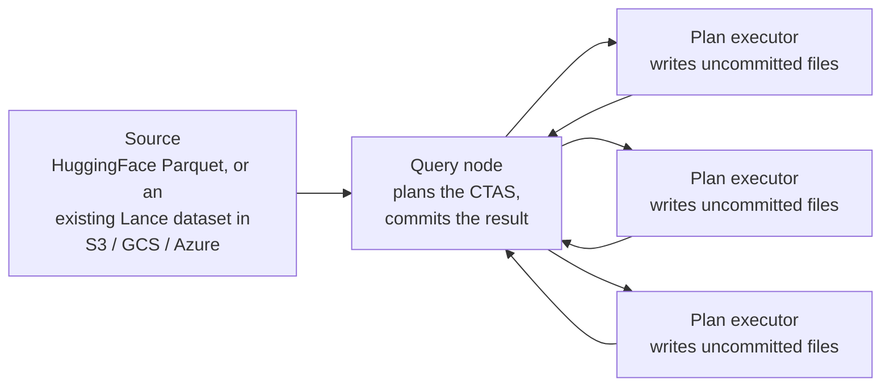

Distributed write applies specifically to importing data with `CREATE
TABLE ... AS SELECT`: the query node that planned the statement partitions
the source -- Parquet files from a HuggingFace dataset, or row-group
ranges of an existing Lance dataset in object storage -- across plan
executors, each of which writes its own uncommitted Lance data files and
reports back. The query node collects those results and commits them
together as the new table's first version; no separate coordinator
service is involved. See [Architecture](/index#architecture).

An ordinary `INSERT` or `merge_insert`, from SQL or the SDK, does not
distribute this way -- it runs as a single write, on whichever node or
process executes it. Only a CTAS import fans the write itself out across
machines.

## Write interfaces {#write-interfaces}

- [Import Datasets](/ingestion/import) for the CTAS syntax this
  distributes.
- [Insert data](/ingestion/insert) and [Merge](/ingestion/merge-insert)
  for the ordinary, non-distributed write paths.
- [Storage Integration](/sql/ddl/storage-integration) for configuring
  the source a CTAS import reads from.
