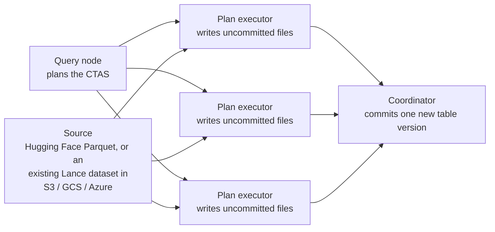

Distributed write applies specifically to importing data with `CREATE
TABLE ... AS SELECT`: Enterprise partitions the source -- Parquet files
from a Hugging Face dataset, or row-group ranges of an existing Lance
dataset in object storage -- across plan executors, each of which writes
its own uncommitted Lance data files, before a coordinator commits them
together as the new table's first version. See
[Architecture](/index#architecture).

An ordinary `INSERT` or `merge_insert`, from SQL or the SDK, does not
distribute this way -- it runs as a single write, on whichever node or
process executes it. Only a CTAS import fans the write itself out across
machines.

## Embedded write {#embedded-write}

LanceDB Embedded writes every table, including one created by a local
`CREATE TABLE ... AS SELECT`, inside your application process, on a
single machine. There is no fleet of plan executors to distribute writes
across.

## Write interfaces {#write-interfaces}

- [Import Datasets](/ingestion/import) for the CTAS syntax this
  distributes.
- [Insert data](/ingestion/insert) and [Merge](/ingestion/merge-insert)
  for the ordinary, non-distributed write paths.
- [Storage Integration](/sql/ddl/storage-integration) for configuring
  the source a CTAS import reads from.
