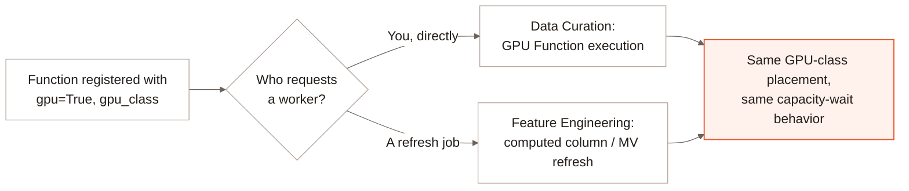

A [computed column](/feature-engineering/add-computed-column) or
[materialized view](/feature-engineering/materialized-views) filled by a
registered [Function](/curation/create-function) with `gpu=True` refreshes
through the exact same placement path as
[GPU Function execution](/curation/gpu-function-execution) in Data
Curation -- refreshing a column is not a separate scheduling code path
from calling the Function directly, just a different caller.

The Function's `gpu_class` (or the deployment's `default`) resolves to the
same node selector, tolerations and resource name either way, and a
refresh that needs more GPU capacity than is currently free waits the
same way a direct call would -- see
[Waiting for capacity](/curation/gpu-function-execution#capacity) for that
behavior in full. [Adaptive Execution](/enterprise/adaptive-execution)'s
resource-consumption-based sizing applies here too: a refresh's GPU
utilization is measured and fed back into sizing the *next* part the same
way CPU and memory are.

A single refresh can also override the Function's registered placement for
that run -- see
[Configure workers and resources](/feature-engineering/refresh-column#resources)
for the `gpu_class`/`gpu_count` options on `refresh_column_async` and the
equivalent SQL `WITH (...)` clause.

## What to read next {#next}

<CardGroup cols={2}>
  <Card title="GPU Function Execution" icon="microchip" href="/curation/gpu-function-execution">
    The full placement and capacity-wait mechanism this page reuses.
  </Card>
  <Card title="Adaptive Execution" icon="gauge-high" href="/enterprise/adaptive-execution">
    How a refresh's resource class, part size and worker count adjust themselves.
  </Card>
  <Card title="Configure workers and resources" icon="sliders" href="/feature-engineering/refresh-column#resources">
    Override GPU class and count for one refresh call.
  </Card>
</CardGroup>
