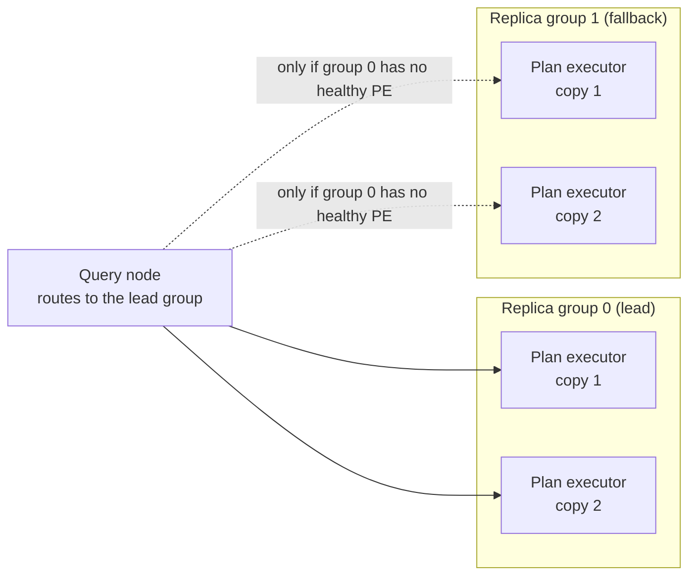

LanceDB Enterprise scales serving capacity by assigning a table to one or
more **replica groups** -- numbered subsets of the plan-executor fleet --
and, within each group, by **replication factor** (RF): how many copies of
the table's data that group holds. A table is served only from the groups
it is explicitly assigned to; adding plan executors to the fleet, or adding
a new group, never auto-includes existing tables. A pristine table that was
never explicitly placed stays on one default group at the cluster's default
RF. See [Architecture](/index#architecture).

Placement is stored in the table's own manifest, not a separate
configuration store, and takes effect for a table within its readers'
read-consistency refresh interval after a change. An index can carry its
own RF override within each of the table's groups instead of inheriting
the table's RF. Reassigning a table's groups or RF is an operator action
(through the admin API, not SQL); [contact support](https://www.lancedb.com/contact)
to change a table's placement.

## Why this scales serving {#why}

More replicas of a hot table's data, across more plan executors, means
more of the fleet can serve that table's queries in parallel -- the same
reasoning as adding query-serving capacity generally (see
[Architecture](/index#architecture)), applied per table rather than
cluster-wide. Replication also gives a table fault tolerance: losing one
plan executor does not take its data offline if another replica still
holds it.

A single query that reads several tables routes every read to the same
replica group -- the intersection of the tables' assigned groups, trying a
lead group first and falling back through the rest of the order if it has
no healthy plan executor. Keeping one query's reads co-located protects the
locality of whichever group's cache is already warm for it, rather than
letting each table's read drift to a different group.

This table is assigned to two replica groups, each at replication factor
2: four plan executors in total, each holding a full copy of the table's
data. Adding a third group, or raising RF within a group, adds more
plan executors that can serve this table's reads in parallel -- scaling
throughput for this one table without touching any other table's
placement.

## Scaling interfaces {#scaling-interfaces}

- [Distributed search](/enterprise/distributed-search) for how a query
  divides across query nodes and plan executors generally.
- [Architecture](/index#architecture) for the components a replica group
  is made of.
