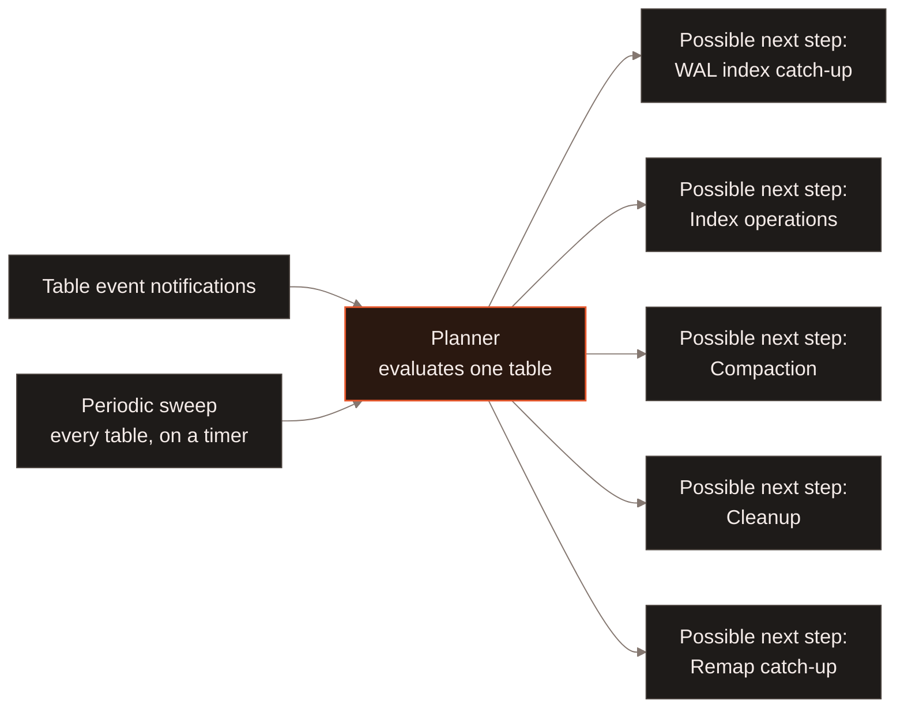
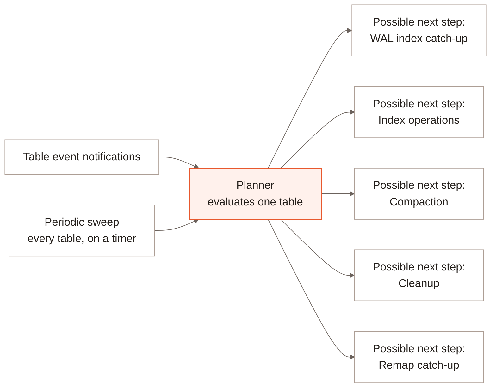

Keeping a table in good condition takes several different kinds of work --
compacting files, catching indexes up, cleaning old versions, folding a
RTE write tier into the base table -- each with its own trigger. In
LanceDB Enterprise, a fleet of agent processes decides when each of these
needs to run, continuously, per table, in the background across your
cluster -- nothing to schedule, trigger, or monitor by hand unless you want
to.

## Tracking activity {#tracking}

An agent's long-running process watches two independent sources for a
table: **table events** (Job Registry notifications, so it learns about a
write, a schema change, or a new index almost immediately) and a
**periodic sweep** that revisits every table it owns on a timer -- 600
seconds by default -- so a table that stops producing events still gets
re-evaluated rather than going stale. A hot table producing a flood of
events does not get to monopolize evaluation: notifications and the
periodic sweep share a bounded per-tick budget, and reads for a given table
run at most once at a time.

Each evaluation reopens the table and reads its manifest, indexes and
in-flight jobs fresh, rather than deciding from a cached guess. Those are
separate reads rather than one atomic snapshot, so a concurrent write
between them is possible; the next evaluation -- triggered by that same
write's own event notification -- is what catches anything the current
one missed.

## Deciding what to run {#deciding}

A table is not reduced to one "next best action" -- each evaluation walks a
fixed, priority-ordered sequence of independent decisions, launching
whichever ones are due:

1. **WAL index catch-up.** Checked first and gated by nothing else, because
   it is correctness-driven rather than discretionary: while an index lags
   behind the compacted generation, the RTE write tier cannot trim its
   log. See [RTE Compaction](/enterprise/realtime-engine-compaction).
2. **Index operations.** Reindexing a column, unless a compaction that
   cannot defer its remap is about to run this same tick -- deferred-remap
   compaction lets index work proceed alongside it instead of waiting. See
   [Incremental Indexing](/indexing/incremental-indexing).
3. **Compaction.** Whether enough small fragments or deleted rows have
   accumulated to merge. See [Compaction](/maintenance/compaction) and
   [Distributed Compaction](/enterprise/distributed-compaction).
4. **Cleanup.** Independent of the other four -- it can always run in
   parallel with them. [See below](#cleanup) for exactly when it's due.
5. **Deferred-remap catch-up.** The batched, amortized follow-up for index
   entries a deferred compaction didn't remap synchronously. See
   [Advanced Conflict Resolution](/enterprise/advanced-conflict-resolution).

More than one of these can fire for the same table in the same evaluation --
a compaction and a cleanup are unrelated and can both launch together -- but
some gate each other where running them at the same time would be unsafe,
like index operations waiting on a compaction that can't defer its remap.

Compaction's four tuning fields can be set per table. Automatic jobs use table
tuning before deployment/built-in defaults; explicit manual invocation values
take precedence over both. Automatic enablement still gates background jobs,
while manual compaction can run with it disabled. Resolved tuning is captured in
each job. See [table compaction defaults](/maintenance/compaction#table-compaction-defaults)
for the fields, precedence, source-budget no-ops, and compatible-version requirements.

### When cleanup is due {#cleanup}

[Cleanup](/maintenance/cleanup) prunes old table versions and the files only
they referenced. In LanceDB Embedded, that always happens because you asked
for it, through a call to `optimize()`. In LanceDB Enterprise, a
[manual `optimize()` call](/maintenance/compaction#enterprise-manual-compaction)
submits compaction only. Cleanup remains this planner's own decision, off by
default unless the deployment sets a minimum version age:
with no minimum age configured, nothing is ever old enough to clean up
automatically, and old versions simply accumulate until an operator enables
it. A table can also disable it individually even when the deployment allows
it, overriding the deployment-wide setting for just that table.

Once enabled, a table becomes due for cleanup when any one of these is true:

| Trigger | Condition |
| --- | --- |
| Enough new versions | The current version has advanced far enough past the version the last successful cleanup started from |
| Enough time has passed | The last successful cleanup finished long enough ago -- the default is 24 hours -- so an idle table whose versions simply age past the retention window still gets revisited |
| Version went backward | The current version is lower than the version the last successful cleanup recorded, which re-triggers a run immediately |

A table that has never had a successful cleanup run is held to its own
initial version threshold first, so a brand-new table is not claimed for
cleanup before it has accumulated enough versions to be worth the pass. A
failed attempt is retried, but not immediately -- a minimum delay (60
seconds by default) must pass after the failure before the table becomes
eligible again, even if one of the triggers above would otherwise fire.

## Confirming it's actually running {#observability}

Rather than asking you to trust that evaluation is happening, the agent
exposes coverage metrics scoped to *successful* evaluations specifically --
a failed or timed-out attempt does not count:

| Metric (`lance_agent_` prefix) | What it tells you |
| --- | --- |
| `coverage_never_evaluated` | Tables this agent owns that have never completed an evaluation |
| `coverage_oldest_success_age_seconds` | How long it's been since the longest-overdue table was last successfully evaluated |
| `coverage_cycle_target` / `coverage_cycle_pending` | How much work the current full sweep has left |
| `coverage_cycles_completed_total` | How many full sweeps have finished |

A cycle freezes its target set of tables up front; new tables join the
*next* cycle rather than resetting progress on the current one, and a table
that disappears or changes ownership is dropped from the target rather than
counted as covered.

## What to read next {#next}

<CardGroup cols={2}>
  <Card title="Cleanup" icon="broom" href="/maintenance/cleanup">
    What a cleanup pass actually removes, and the retention window it respects.
  </Card>
  <Card title="Advanced Conflict Resolution" icon="shuffle" href="/enterprise/advanced-conflict-resolution">
    Why compaction and index maintenance need the deferred-remap decision at all.
  </Card>
  <Card title="RTE Compaction" icon="compress" href="/enterprise/realtime-engine-compaction">
    The WAL-tier compaction this page's Decision 1 depends on.
  </Card>
  <Card title="Incremental Indexing" icon="refresh" href="/indexing/incremental-indexing">
    What an index operation actually does once scheduled.
  </Card>
  <Card title="OpenTelemetry" icon="chart-line" href="/deployment/opentelemetry">
    Viewing the `lance_agent_*` coverage metrics above.
  </Card>
</CardGroup>
