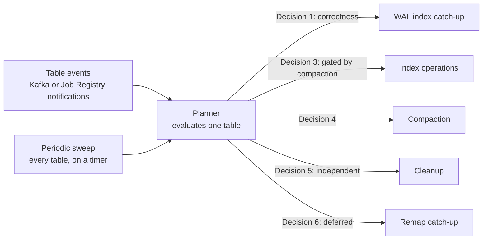

Keeping a table in good condition takes several different kinds of work --
compacting files, catching indexes up, cleaning old versions, folding a
real-time write tier into the base table -- each with its own trigger. In
LanceDB Enterprise, a fleet of agent processes decides when each of these
needs to run, continuously, per table, so nothing has to be scheduled by
hand.

## Tracking activity {#tracking}

An agent's long-running process watches two independent sources for a
table: **table events** (either Kafka or Job Registry notifications, so it
learns about a write, a schema change, or a new index almost immediately)
and a **periodic sweep** that revisits every table it owns on a timer --
600 seconds by default -- so a table that stops producing events still gets
re-evaluated rather than going stale. A hot table producing a flood of
events does not get to monopolize evaluation: notifications and the
periodic sweep share a bounded per-tick budget, and reads for a given table
run at most once at a time.

Each evaluation reopens the table, reads its current manifest, indexes and
in-flight jobs, and only then decides what, if anything, to launch -- so a
decision is always made against that table's actual current state, not a
cached guess.

## Deciding what to run {#deciding}

A table is not reduced to one "next best action" -- each evaluation walks a
fixed, priority-ordered sequence of independent decisions, launching
whichever ones are due:

1. **WAL index catch-up.** Checked first and gated by nothing else, because
   it is correctness-driven rather than discretionary: while an index lags
   behind the compacted generation, the real-time write tier cannot trim its
   log. See [Real Time Engine compaction](/enterprise/realtime-engine-compaction).
2. **Index operations.** Reindexing a column, unless a compaction that
   cannot defer its remap is about to run this same tick -- deferred-remap
   compaction lets index work proceed alongside it instead of waiting. See
   [Incremental Indexing](/indexing/incremental-indexing).
3. **Compaction.** Whether enough small fragments or deleted rows have
   accumulated to merge. See [Compaction](/maintenance/compaction) and
   [Distributed compaction](/enterprise/distributed-compaction).
4. **Cleanup.** Independent of the other four -- it can always run in
   parallel with them. See [Automated Cleanup](/enterprise/automated-cleanup).
5. **Deferred-remap catch-up.** The batched, amortized follow-up for index
   entries a deferred compaction didn't remap synchronously. See
   [Advanced Conflict Resolution](/enterprise/advanced-conflict-resolution).

More than one of these can fire for the same table in the same evaluation --
a compaction and a cleanup are unrelated and can both launch together -- but
some gate each other where running them at the same time would be unsafe,
like index operations waiting on a compaction that can't defer its remap.

## Confirming it's actually running {#observability}

Rather than asking you to trust that evaluation is happening, the agent
exposes coverage metrics scoped to *successful* evaluations specifically --
a failed or timed-out attempt does not count:

| Metric (`lance_agent_` prefix) | What it tells you |
| --- | --- |
| `coverage_never_evaluated` | Tables this agent owns that have never completed an evaluation |
| `coverage_oldest_success_age_seconds` | How long it's been since the longest-overdue table was last successfully evaluated |
| `coverage_cycle_target` / `coverage_cycle_pending` | How much work the current full sweep has left |
| `coverage_cycles_completed_total` | How many full sweeps have finished |

A cycle freezes its target set of tables up front; new tables join the
*next* cycle rather than resetting progress on the current one, and a table
that disappears or changes ownership is dropped from the target rather than
counted as covered.

## What to read next {#next}

<CardGroup cols={2}>
  <Card title="Advanced Conflict Resolution" icon="shuffle" href="/enterprise/advanced-conflict-resolution">
    Why compaction and index maintenance need the deferred-remap decision at all.
  </Card>
  <Card title="Automated Cleanup" icon="clock" href="/enterprise/automated-cleanup">
    The cleanup decision's own triggers, in depth.
  </Card>
  <Card title="Real Time Engine compaction" icon="compress" href="/enterprise/realtime-engine-compaction">
    The WAL-tier compaction this page's Decision 1 depends on.
  </Card>
  <Card title="Incremental Indexing" icon="refresh" href="/indexing/incremental-indexing">
    What an index operation actually does once scheduled.
  </Card>
</CardGroup>
