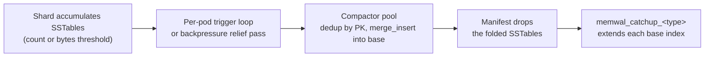
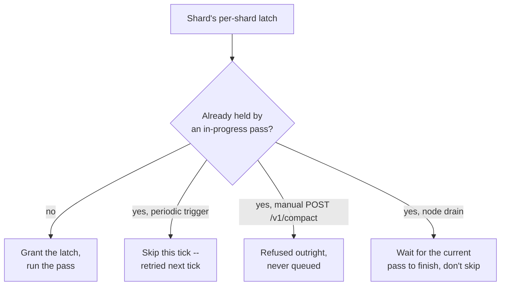

[Distributed compaction](/enterprise/distributed-compaction) merges small
base-table fragments and reclaims deleted rows -- the same operation
[Compaction](/maintenance/compaction) describes for LanceDB Embedded. A
table with the [real time engine](/tables/realtime-engine) enabled has a
second, unrelated compaction: folding a shard's accumulated SSTables into
the base table and catching the base table's indexes up over the rows that
just landed. This produces two job types, `memwal_compaction` and
`memwal_catchup_<type>`, already distinct from ordinary `compact` in
`SHOW JOBS` and `list_jobs`. This page covers how Enterprise decides when
to run them, not just what they do.

## What triggers a compaction pass {#trigger}

A per-pod loop, ticking every `WAL_COMPACTION_INTERVAL_SECS` (30s by
default), walks every table this pod owns and reads each shard's manifest.
It dispatches a compaction job for a shard once either threshold crosses:

| Trigger | Default | Checks |
| --- | --- | --- |
| `WAL_COMPACT_TRIGGER_COUNT` | 3 | The shard's SSTable count |
| `WAL_COMPACT_TRIGGER_BYTES` | 750 MiB | The shard's total flushed SSTable bytes |

Whichever crosses first wins; there is no minimum age a pass waits for past
that. A shard under write pressure does not wait for the next tick either:
the same two thresholds are re-checked on every backpressure relief pass,
so a hot shard that already qualifies compacts sooner than
`WAL_COMPACTION_INTERVAL_SECS` would otherwise allow. Setting
`WAL_COMPACTION_INTERVAL_SECS` to `0` disables the periodic walk; an
operator can still force a pass with `POST /v1/compact`, and
`Table::checkpoint_rte` drives the same flush-then-compact cycle from the
client when you need a table to converge on demand rather than wait for
the trigger. `checkpoint_rte` has no liveness bound of its own -- it is
idempotent and abandonable at any point, but the caller owns the deadline
for how long to wait on it.

This trigger decision is internal to the WAL pod -- it is not the general
job scheduler deciding to run `memwal_compaction`, the pod decides to
enqueue one. Once enqueued, the work is still tracked as an ordinary job
(`memwal_compaction`, then `memwal_catchup_<type>` once it lands), so
`SHOW JOBS` and `list_jobs` surface it the same way they surface any other
background job.

## What one pass does {#pass}

A per-pod compactor pool, shared across every table that pod owns, runs
the passes a tick enqueues (`WAL_COMPACT_CONCURRENCY`, 2 concurrent jobs by
default):

1. Snapshot the shard's current list of SSTables.
2. Take a bounded prefix of them, oldest first (`WAL_COMPACT_PREFIX_MAX`,
   8 by default).
3. Open each as a Lance file and scan its rows.
4. Deduplicate across the prefix by primary key -- a later SSTable's row
   wins over an earlier one with the same key.
5. Merge the deduplicated rows into the base table with `merge_insert`.
6. Commit a manifest update that drops exactly the SSTables just folded
   in, identified individually rather than by position, so a retried
   commit against a newer manifest can't drop the wrong ones.
7. `memwal_catchup_<type>` then extends each of the base table's indexes
   -- one job per index type (`memwal_catchup_btree`, `memwal_catchup_fts`,
   `memwal_catchup_ivfpq`, and so on) -- over the rows step 5 just added,
   and records how far that index has caught up.

Only one compaction pass runs against a given shard at a time. A second,
concurrent pass against the same shard would corrupt it: a stale pass can
overwrite rows a newer generation already replaced, or resurrect a row a
newer generation deleted, since the merge step has no way to tell a
late-arriving write from a value that was already superseded. A per-shard
latch enforces this -- the periodic trigger skips a shard that's already
compacting, a manual `POST /v1/compact` is refused outright (never queued)
on the same collision, and node drain waits for the shard's current pass
instead of skipping it, since a skipped table is exactly what drain exists
to flush.

## Reading while compaction runs {#reads}

A query against an RTE-enabled table always reads the shard's current
memtable and SSTables unioned with the base table, regardless of where a
compaction pass is in its cycle -- compaction only ever changes which side
of that union a row's latest value lives on, never which value is
current. There's no window where a row is visible in neither side: the
manifest update in step 6 is the single point where a row's SSTable copy
stops being listed, and it only commits after `merge_insert` has already
written that row into the base table.

A table queried *without* the real time engine's live path only sees data
once it has been folded into the base table, so its staleness bound tracks
the compaction cadence: `WAL_COMPACTION_INTERVAL_SECS` at most before a
shard's trigger is even checked, plus the compaction job's own runtime --
wider either way than the real time engine's own millisecond-scale
freshness. That bound assumes the per-pod compactor pool has a free slot
when the shard becomes eligible; under `WAL_COMPACT_CONCURRENCY` jobs
already running for other tables the same pod owns, an eligible shard
waits in queue, so the actual delay can run longer than the interval and
one job's runtime alone suggest. See [Real Time reads](/search/realtime-read)
for what a live RTE read sees instead.

## What to read next {#next}

<CardGroup cols={2}>
  <Card title="Real Time Engine" icon="bolt" href="/tables/realtime-engine">
    The MemWAL format, shards, and WAL nodes this page assumes.
  </Card>
  <Card title="Distributed compaction" icon="compress" href="/enterprise/distributed-compaction">
    The unrelated, ordinary compaction every table -- WAL-enabled or not -- gets.
  </Card>
  <Card title="Job Framework" icon="list-check" href="/basics/jobs">
    Job handles, waiting, and inspecting jobs -- memwal_compaction included.
  </Card>
</CardGroup>
