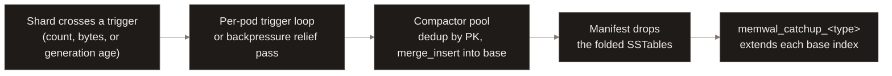
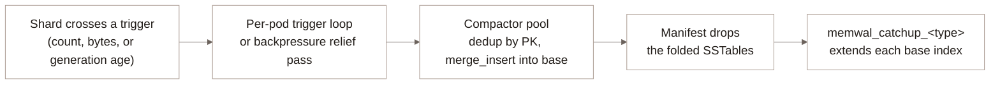
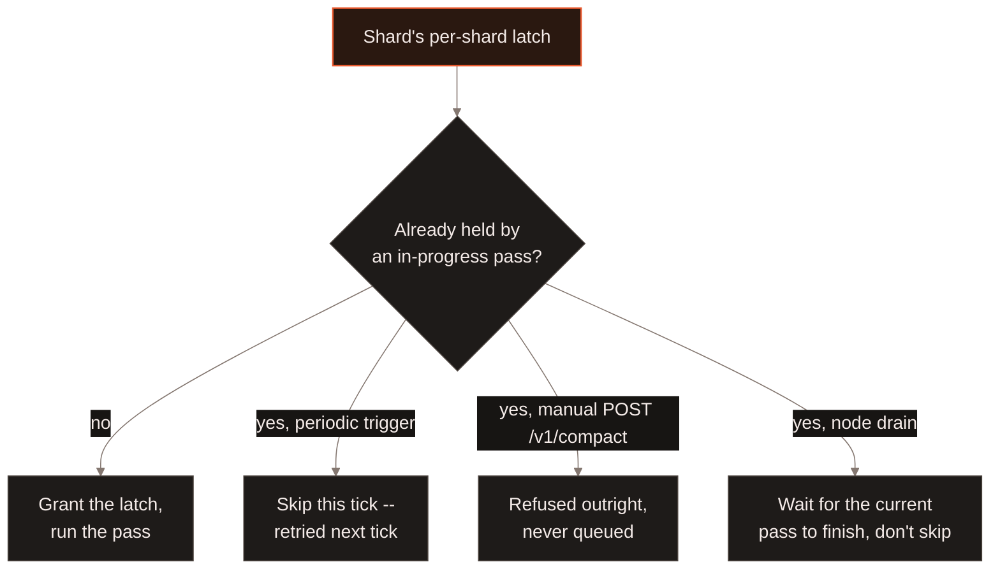
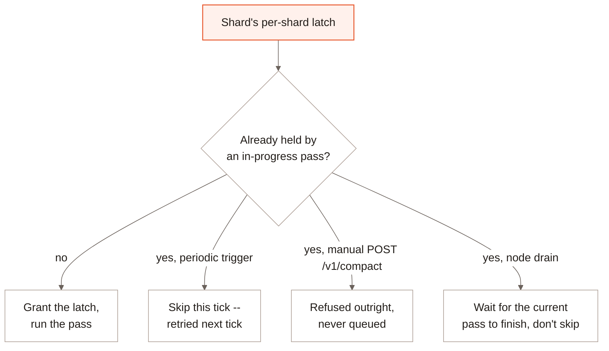

[Distributed Compaction](/enterprise/distributed-compaction) merges small
base-table fragments and reclaims deleted rows -- the same operation
[Compaction](/maintenance/compaction) describes for LanceDB Embedded. A
table with the [real time engine](/tables/realtime-engine) enabled has a
second, unrelated compaction: folding a shard's accumulated SSTables into
the base table and catching the base table's indexes up over the rows that
just landed. This produces two job types, `memwal_compaction` and
`memwal_catchup_<type>`, already distinct from ordinary `compact` in
`SHOW JOBS` and `list_jobs`. This page covers how Enterprise decides when
to run them, not just what they do.

## What triggers a compaction pass {#trigger}

A per-pod loop, ticking every `WAL_COMPACTION_INTERVAL_SECS` (5s by
default), walks every table this pod owns and reads each shard's manifest.
It dispatches a compaction job for a shard once any threshold crosses:

| Trigger | Default | Checks |
| --- | --- | --- |
| `WAL_COMPACT_TRIGGER_COUNT` | 4 | The shard's SSTable count |
| `WAL_COMPACT_TRIGGER_BYTES` | 1 GiB | The shard's total flushed SSTable bytes |
| Oldest generation's age | 7 days | How long the head SSTable generation has sat, whatever the file count -- a file that will never gather enough siblings to cross the count trigger still gets compacted eventually |

Whichever crosses first wins. A shard under write pressure does not wait
for the next tick either: the same thresholds are re-checked on every
backpressure relief pass, so a hot shard that already qualifies compacts
sooner than `WAL_COMPACTION_INTERVAL_SECS` would otherwise allow. Setting
`WAL_COMPACTION_INTERVAL_SECS` to `0` disables the periodic walk; an
operator can still force a pass with `POST /v1/compact`, and
`Table::checkpoint_rte` drives the same flush-then-compact cycle from the
client when you need a table to converge on demand rather than wait for
the trigger. `checkpoint_rte` has no liveness bound of its own -- it is
idempotent and abandonable at any point, but the caller owns the deadline
for how long to wait on it.

This trigger decision is internal to the WAL pod -- it is not the general
job scheduler deciding to run `memwal_compaction`, the pod decides to
enqueue one. Once enqueued, the work is still tracked as an ordinary job
(`memwal_compaction`, then `memwal_catchup_<type>` once it lands), so
`SHOW JOBS` and `list_jobs` surface it the same way they surface any other
background job.

## What one pass does {#pass}

By default (`wal.remoteMaintenance` is on), a tick's passes are offloaded
as ordinary Job Registry worker jobs instead of running in the WAL pod
itself, up to `WAL_COMPACT_CONCURRENCY` at a time (32 by default). With
remote maintenance off, the pod runs them itself, in a per-pod compactor
pool shared across every table it owns, bounded to 2 concurrent passes
instead. Either way, each pass:

1. Snapshots the shard's current list of SSTables.
2. Takes a bounded prefix of them, oldest first (`WAL_COMPACT_PREFIX_MAX`,
   32 by default), further capped at `COMPACT_PASS_TARGET_BYTES` (2 GiB)
   -- a budget every in-pod pass shares, but that an offloaded pass gets
   in full to itself.
3. Opens each as a Lance file and scans its rows.
4. Deduplicates across the prefix by primary key -- a later SSTable's row
   wins over an earlier one with the same key.
5. Merges the deduplicated rows into the base table with `merge_insert`.
6. Commits a manifest update that drops exactly the SSTables just folded
   in, identified individually rather than by position, so a retried
   commit against a newer manifest can't drop the wrong ones.
7. `memwal_catchup_<type>` then extends each of the base table's indexes
   -- one job per index type (`memwal_catchup_btree`, `memwal_catchup_fts`,
   `memwal_catchup_ivfpq`, and so on) -- over the rows step 5 just added,
   and records how far that index has caught up.

Only one compaction pass runs against a given shard at a time. A second,
concurrent pass against the same shard would corrupt it: a stale pass can
overwrite rows a newer generation already replaced, or resurrect a row a
newer generation deleted, since the merge step has no way to tell a
late-arriving write from a value that was already superseded. A per-shard
latch enforces this -- the periodic trigger skips a shard that's already
compacting, a manual `POST /v1/compact` is refused outright (never queued)
on the same collision, and node drain waits for the shard's current pass
instead of skipping it, since a skipped table is exactly what drain exists
to flush.

## Reading while compaction runs {#reads}

A query against an RTE-enabled table always reads the shard's current
memtable and SSTables unioned with the base table, regardless of where a
compaction pass is in its cycle -- compaction only ever changes which side
of that union a row's latest value lives on, never which value is
current. There's no window where a row is visible in neither side: the
manifest update in step 6 is the single point where a row's SSTable copy
stops being listed, and it only commits after `merge_insert` has already
written that row into the base table.

A table queried *without* the real time engine's live path only sees data
once it has been folded into the base table, so its staleness bound tracks
whichever trigger fires -- wider either way than the real time engine's
own millisecond-scale freshness. A shard under steady write pressure
compacts on the count or bytes trigger, within `WAL_COMPACTION_INTERVAL_SECS`
plus the compaction job's own runtime. A shard that never gathers enough
siblings or bytes instead waits on the age trigger, up to 7 days by
default, before it's compacted at all. `WAL_MAX_DATA_AGE_SECS` bounds two
independent stages -- the memtable freeze and this compaction age trigger
-- so a slow table's worst-case staleness without the live path is up to
roughly twice that default, not one interval plus one job's runtime.
Either way, the bound also assumes a free compaction slot when
the shard becomes eligible; an eligible shard can wait in queue behind
`WAL_COMPACT_CONCURRENCY` other passes already running, so the actual
delay can run longer than the trigger alone suggests. See
[RTE reads](/search/realtime-read)
for what a live RTE read sees instead.

## What to read next {#next}

<CardGroup cols={2}>
  <Card title="Real Time Engine" icon="bolt" href="/tables/realtime-engine">
    The MemWAL format, shards, and WAL nodes this page assumes.
  </Card>
  <Card title="Distributed Compaction" icon="compress" href="/enterprise/distributed-compaction">
    The unrelated, ordinary compaction every table -- WAL-enabled or not -- gets.
  </Card>
  <Card title="Job Framework" icon="list-check" href="/basics/jobs">
    Job handles, waiting, and inspecting jobs -- memwal_compaction included.
  </Card>
</CardGroup>
