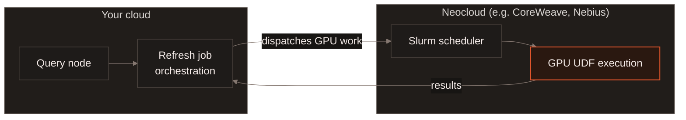
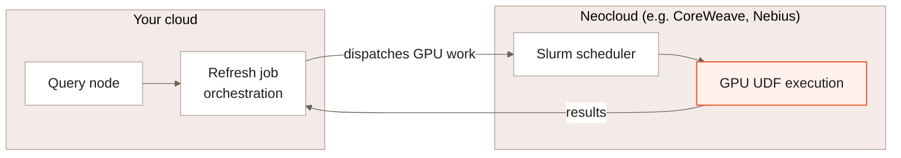

[Slurm scheduling](/curation/slurm-scheduling) lets LanceDB Enterprise's
pods run under the same scheduler as GPU training infrastructure -- that
mechanism applies to a computed column or materialized view refresh the
same way it applies to the rest of the deployment. This page covers what's
specific to refresh: running a refresh's GPU-bound Functions on a
**different cloud** from the one your deployment lives in.

## How it fits together {#architecture}

A refresh job splits into two parts that don't have to run in the same
place: the orchestration -- planning the refresh, tracking its progress,
committing results -- stays with your LanceDB Enterprise deployment in its
own cloud. The GPU-bound Function calls a refresh needs can instead
dispatch to a Neocloud's Slurm-scheduled GPU pool, in a separate cloud
account and region, and send their results back to complete the refresh.

## Why it matters {#why-it-matters}

GPU capacity is often cheaper and more available on a Neocloud built
around Slurm-scheduled GPU clusters than inside a general-purpose cloud.
Splitting orchestration from GPU execution means you don't have to choose
between keeping your deployment where your data and other infrastructure
already live, and getting access to that GPU capacity -- a refresh can do
both, without migrating the deployment or provisioning GPUs in your
primary cloud at all.

[Contact us](https://www.lancedb.com/contact) to learn more about setting
up cross-cloud GPU execution for your deployment.

## What to read next {#next}

<CardGroup cols={2}>
  <Card title="Slurm Scheduling" icon="server" href="/curation/slurm-scheduling">
    The scheduling mechanism this page's cross-cloud case builds on.
  </Card>
  <Card title="Adaptive Execution" icon="gauge-high" href="/enterprise/adaptive-execution">
    How a refresh's resource class, part size and worker count adjust themselves.
  </Card>
</CardGroup>
