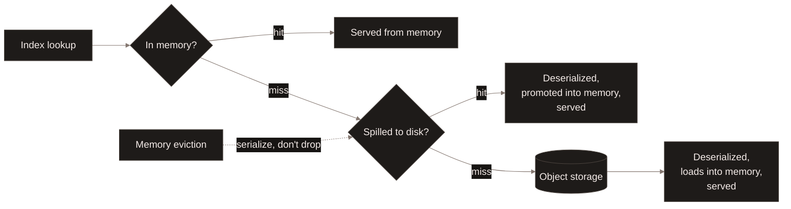
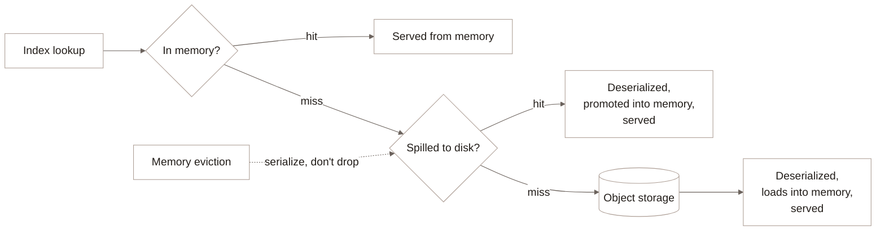

<Badge color="purple">Early access</Badge>

The tiered index cache holds deserialized vector, full-text and scalar
index structures in memory, backed by a local-disk tier beneath it. When
memory fills, the cache serializes evicted entries and spills them to disk
instead of dropping them; a later hit on a spilled entry promotes it back
into memory. This lets a plan executor serve an index larger than its
available memory without re-reading and re-deserializing it from object
storage on every eviction. See [Architecture](/index#architecture).

## Sharing the disk budget {#disk-budget}

Where enabled, the index disk tier and the
[data page cache](/enterprise/data-page-cache)'s disk tier draw from one
combined disk allocation per executor: a configurable percentage of the
provisioned volume (90% by default, leaving headroom for filesystem
metadata and kubelet usage), out of which the index disk tier reserves its
own configurable share of the *full* provisioned volume. On a 200 GiB
volume, the 90% default leaves 180 GiB combined; reserving 25% of the full
200 GiB (50 GiB) for the index disk tier leaves the remaining 130 GiB for
data pages. An exact byte split overrides the percentage split when you
need one tier sized precisely rather than proportionally. Setting the
index disk tier's share to zero disables it while leaving the in-memory
index cache and the data page cache's disk tier untouched.

## Index cache interfaces {#interfaces}

- [Cache Prewarm](/enterprise/cache-prewarm) for how `startup_prewarm_idx`
  warms this cache ahead of the first request.
- [Data Page Cache](/enterprise/data-page-cache) for the related cache
  that holds raw table data pages instead of deserialized index structures.
- [Vector indexes](/indexing/vector-index), [full-text indexes](/indexing/fts-index),
  and [scalar indexes](/indexing/scalar-index) for the index types this
  cache serves.
