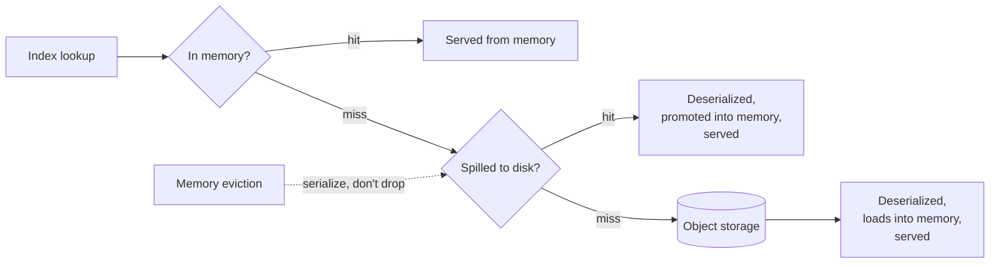

<Info>
Tiered index cache is in **Early Availability (EA)**. Confirm availability for
your deployment's release with your deployment operator or LanceDB support.
</Info>

The tiered index cache holds deserialized vector, full-text and scalar
index structures in memory, backed by a local-disk tier beneath it. When
memory fills, the cache serializes evicted entries and spills them to disk
instead of dropping them; a later hit on a spilled entry promotes it back
into memory. This lets a plan executor serve an index larger than its
available memory without re-reading and re-deserializing it from object
storage on every eviction. See [Architecture](/index#architecture).



## Sharing the disk budget {#disk-budget}

Where enabled, the index disk tier and the
[data page cache](/enterprise/data-page-cache)'s disk tier draw from one
combined disk allocation per executor: a configurable percentage of the
provisioned volume (90% by default, leaving headroom for filesystem
metadata and kubelet usage), out of which the index disk tier reserves its
own configurable share of the *full* provisioned volume. On a 200 GiB
volume, the 90% default leaves 180 GiB combined; reserving 25% of the full
200 GiB (50 GiB) for the index disk tier leaves the remaining 130 GiB for
data pages. An exact byte split overrides the percentage split when you
need one tier sized precisely rather than proportionally. Setting the
index disk tier's share to zero disables it while leaving the in-memory
index cache and the data page cache's disk tier untouched.

### Enable the disk tier {#enable-and-check-the-disk-tier}

For a Helm deployment, the disk tier requires distributed search, a disk-cache
volume, and a nonzero disk allocation for indexes. Add these values to your
deployment's existing Helm configuration. This example assumes an NVMe-backed
StorageClass named `local-nvme`; use the StorageClass provided by your cluster.

```yaml Helm values
global:
  distributedSearchEnabled: true

planExecutorNodes:
  args:
    indexCacheSizePercentage: 0.2
  diskCache:
    enabled: true
    storageSize: "200Gi"
    storageClassName: "local-nvme"
    capacityPercent: 90
    tieredIndexCacheCapacityPercent: 25
```

The settings in this example have these effects:

- `global.distributedSearchEnabled: true` enables distributed search on query
  nodes and executors.
- `planExecutorNodes.args.indexCacheSizePercentage: 0.2` sets the in-memory
  index cache budget to **20% of each executor's memory**.
- `planExecutorNodes.diskCache.enabled: true` enables the disk-cache volume
  managed by the chart.
- `planExecutorNodes.diskCache.storageSize: "200Gi"` sets the volume size to
  **200 GiB per executor**.
- `planExecutorNodes.diskCache.storageClassName: "local-nvme"` selects the
  cluster's NVMe-backed StorageClass for that volume.
- `planExecutorNodes.diskCache.capacityPercent: 90` budgets **180 GiB** for the
  index disk tier and data page cache together, leaving **20 GiB of headroom**.
- `planExecutorNodes.diskCache.tieredIndexCacheCapacityPercent: 25` reserves
  **25% of the full volume**, or **50 GiB**, for the index disk tier. The data
  page cache gets the remaining **130 GiB**: `(90% - 25%) × 200 GiB`.
  This value must be nonnegative and less than `capacityPercent`. Set it to `0`
  to disable the index disk tier while retaining the in-memory index cache.

For an exact disk budget, set `tieredIndexCacheCapacityBytes`, which overrides
`tieredIndexCacheCapacityPercent`. For example, this reserves
800 GiB for indices and leaves 820 GiB for data pages on a 1800 GiB volume:

```yaml Helm values
planExecutorNodes:
  diskCache:
    storageSize: "1800Gi"
    capacityPercent: 90
    tieredIndexCacheCapacityBytes: 858993459200
```

The absolute capacity must be a nonnegative integer smaller than the combined
cache budget. An absolute capacity of `0` disables the index disk tier.

## Index cache interfaces {#interfaces}

- [Cache Prewarm](/enterprise/cache-prewarm) for how `startup_prewarm_idx`
  warms this cache ahead of the first request.
- [Data Page Cache](/enterprise/data-page-cache) for the related cache
  that holds raw table data pages instead of deserialized index structures.
- [Vector indexes](/indexing/vector-index), [full-text indexes](/indexing/fts-index),
  and [scalar indexes](/indexing/scalar-index) for the index types this
  cache serves.
