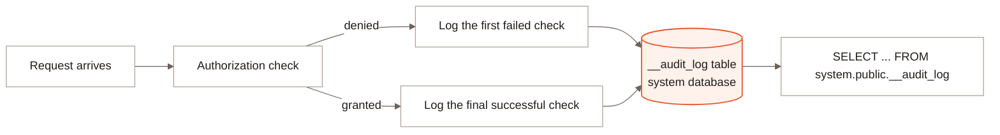

Every authorization check in LanceDB Enterprise -- the principal, the
privilege that was checked, and the object it was checked against -- can
be recorded as a durable audit log entry. On a failed check, the first
failure is logged; on success, the final successful check is logged.

<div className="hidden dark:block">


</div>

<div className="block dark:hidden">



</div>

A deployment chooses how audit records are kept: discarded, written
alongside ordinary application logs, or stored durably as rows in a Lance
table. Only the durable Lance-backed sink produces something you can
query with SQL -- the other two modes exist, but leave nothing in the
table this page describes.

## Schema {#schema}

| Column | Type | Nullable | What it holds |
| --- | --- | --- | --- |
| `AccessId` | string | no | The record's own unique ID, a UUIDv4 in hyphenated text form |
| `AccessTime` | timestamp (microsecond, UTC) | no | When the check happened |
| `PrincipalId` | string | no | The checked principal's ID |
| `PrincipalName` | string | yes | The principal's display name, where known |
| `Object` | string | yes | The object checked against, when the operation maps to a single object |
| `AccessType` | string | no | The privilege that was checked |
| `Description` | string | no | A human-readable description of the check |
| `RequestId` | string | yes | The query node's own request ID, for correlating with request logs |
| `Granted` | boolean | no | Whether the check succeeded |

`RequestId` ties an authorization decision back to the request that
produced it -- both the REST and Flight SQL transports accept only UUID
request IDs, generating one when a request arrives without a valid one,
so this column is always a canonical UUID string when present.

## Accessing it {#access}

The audit log is an ordinary table, not a special API -- it lives in the
`system` database's `public` namespace under the name `__audit_log` by
default (a deployment can configure a different suffix, producing
`__audit_<suffix>` instead, but the `__audit_` prefix is fixed to keep
every audit table in its own part of the system database's namespace).
Query it the same way you would any other table, with its full three-part
name:

<CodeGroup>
```sql SQL icon="database"
SELECT PrincipalName, AccessType, Object, Granted, AccessTime
FROM system.public.__audit_log
WHERE Granted = false
ORDER BY AccessTime DESC
LIMIT 100
```
</CodeGroup>

## Durability {#durability}

The Lance-backed sink batches records in the background instead of writing
on the request path: a batch flushes once it reaches a configured size or
once its oldest record has waited a configured linger period, whichever
comes first. Its queue holds a bounded number of pending records; once full,
requests producing new records wait for the writer to drain it rather than
having a record dropped, and a failed write is retried with growing backoff
rather than abandoned -- so a sink that cannot keep up applies back pressure
and, if sustained, eventually blocks request handling instead of silently
losing entries. The audit table is opened at service startup rather than on
first use, so a misconfigured or unreachable sink fails startup instead of
surfacing the first time something needs to be logged.

This page does not cover retention -- how long written records are kept, or
whether anything prunes them -- which a deployment operator should confirm
for your version and configuration.

## Granting access {#grant}

`system` is not a grantable database -- SQL refuses `GRANT ... ON DATABASE
system`. Reaching into it instead requires `USAGE` on the `SYSTEM`
authorization object, plus `SELECT` on the table itself. Only a superuser
can run these grants. See [Privileges](/governance/privileges#sql) for the
full `GRANT`/`REVOKE` syntax:

<CodeGroup>
```sql SQL icon="database"
GRANT USAGE ON SYSTEM TO ROLE security_team
GRANT SELECT ON TABLE system.public.__audit_log TO ROLE security_team
```
</CodeGroup>

System `USAGE` is broad: beyond reaching the audit log, it also lets the
grantee list every job and its events, look up identities, and run
untargeted `SHOW GRANTS` / `SHOW ROLE BINDINGS`. Grant it deliberately,
not as an incidental step toward audit-log access.

The audit log itself still records who was granted access and who reads
it -- granting and querying it are both authorization checks like any
other, so they appear as rows in the table they govern.

## What to read next {#next}

<CardGroup cols={2}>
  <Card title="Compliance" icon="certificate" href="/enterprise/security">
    Certifications, data handling, and the controls a deployment provides.
  </Card>
  <Card title="Privileges" icon="key" href="/governance/privileges">
    The full privilege model, and how creation privileges resolve upward.
  </Card>
</CardGroup>
