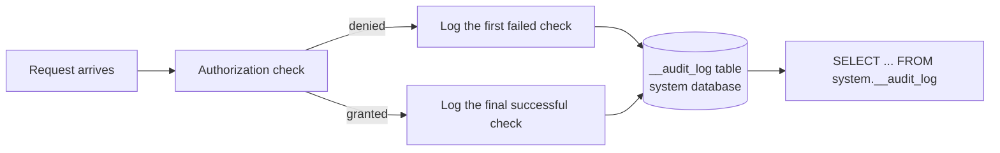

Every authorization check in LanceDB Enterprise -- the principal, the
privilege that was checked, and the object it was checked against -- can
be recorded as a durable audit log entry. On a failed check, the first
failure is logged; on success, the final successful check is logged.



A deployment chooses how audit records are kept: discarded, written
alongside ordinary application logs, or stored durably as rows in a Lance
table. Only the durable Lance-backed sink produces something you can
query with SQL -- the other two modes exist, but leave nothing in the
table this page describes.

## Schema {#schema}

| Column | Type | Nullable | What it holds |
| --- | --- | --- | --- |
| `AccessId` | string | no | The record's own unique ID |
| `AccessTime` | timestamp (microsecond, UTC) | no | When the check happened |
| `PrincipalId` | string | no | The checked principal's ID |
| `PrincipalName` | string | yes | The principal's display name, where known |
| `Object` | string | yes | The object checked against, when the operation maps to a single object |
| `AccessType` | string | no | The privilege that was checked |
| `Description` | string | no | A human-readable description of the check |
| `RequestId` | string | yes | The query node's own request ID, for correlating with request logs |
| `Granted` | boolean | no | Whether the check succeeded |

`RequestId` ties an authorization decision back to the request that
produced it -- both the REST and Flight SQL transports accept only UUID
request IDs, generating one when a request arrives without a valid one,
so this column is always a canonical UUID string when present.

## Accessing it {#access}

The audit log is an ordinary table, not a special API -- it lives in the
`system` database under the name `__audit_log` by default (a deployment
can configure a different suffix, producing `__audit_<suffix>` instead,
but the `__audit_` prefix is fixed to keep every audit table in its own
part of the system database's namespace). Query it the same way you would
any other table:

<CodeGroup>
```sql SQL icon="database"
SELECT PrincipalName, AccessType, Object, Granted, AccessTime
FROM system.__audit_log
WHERE Granted = false
ORDER BY AccessTime DESC
LIMIT 100
```
</CodeGroup>

## Granting access {#grant}

Reading `system.__audit_log` requires the same privileges any other table
read does: `USAGE` on the `system` database to reach into it, and
`SELECT` on the table itself. See [Privileges](/governance/privileges#sql)
for the full `GRANT`/`REVOKE` syntax:

<CodeGroup>
```sql SQL icon="database"
GRANT USAGE ON DATABASE system TO ROLE security_team
GRANT SELECT ON TABLE system.__audit_log TO ROLE security_team
```
</CodeGroup>

The audit log itself still records who was granted access and who reads
it -- granting and querying it are both authorization checks like any
other, so they appear as rows in the table they govern.

## What to read next {#next}

<CardGroup cols={2}>
  <Card title="Compliance" icon="certificate" href="/enterprise/security">
    Certifications, data handling, and the controls a deployment provides.
  </Card>
  <Card title="Privileges" icon="key" href="/governance/privileges">
    The full privilege model, and how creation privileges resolve upward.
  </Card>
</CardGroup>
