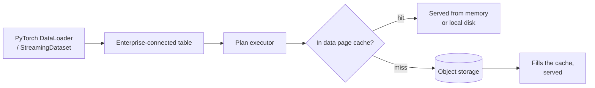

The [PyTorch data loader](/training/data-loading) reads training data the
same way any other query does -- there is no training-specific read path.
Point `StreamingDataset` or a `DataLoader` at a table opened through an
Enterprise connection instead of a local one, and every read it makes
flows through the same [plan executors](/enterprise/data-page-cache) that
serve every other query, with the same data page cache in front of object
storage. No training-specific configuration turns this on; it's a
consequence of connecting to Enterprise at all.

This covers the ordinary tabular columns a query reads -- the data page
cache's unit is a fixed-size page of table data. A [Blob v2](/management/table#managed-blobs)
column's payload is fetched through a separate range-request path keyed
to its own descriptor, not through this cache, so a training table mixing
plain feature columns with Blob v2 images or video gets this benefit only
for the former. A custom collate function or transform that does its own
file or network I/O -- decoding an image, say -- is also outside this
cache; only reads that go through the table query path benefit.

## Why this matters for training specifically {#why}

Training reads the same rows repeatedly: once per epoch, often for many
epochs. The first epoch's reads behave like any cold cache -- a miss per
page, each one filling the cache on the way. Every epoch after that reads
the same pages again, so a dataset that fits the cache's budget serves
almost entirely from memory or local disk after the first pass, instead of
re-reading object storage every epoch. A local-file or Embedded
connection has no equivalent remote cache to warm this way -- its
locality comes from whatever the local filesystem or OS page cache
already does.

[Cache Prewarm](/enterprise/cache-prewarm) extends this further: a plan
executor can warm its cache at startup, before training even begins,
instead of paying the first-epoch cold-cache cost during the run itself.

## What to read next {#next}

<CardGroup cols={2}>
  <Card title="PyTorch Data Loader" icon="boxes-stacked" href="/training/data-loading">
    Connecting a DataLoader to an Enterprise table.
  </Card>
  <Card title="Data Page Cache" icon="database" href="/enterprise/data-page-cache">
    How the cache a training read benefits from actually works.
  </Card>
  <Card title="Cache Prewarm" icon="fire" href="/enterprise/cache-prewarm">
    Warming the cache before the first epoch instead of during it.
  </Card>
</CardGroup>
